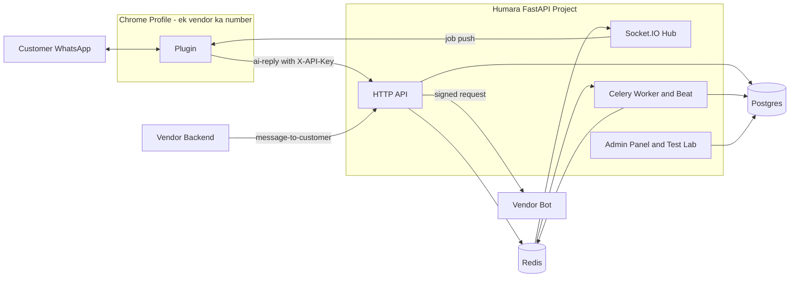
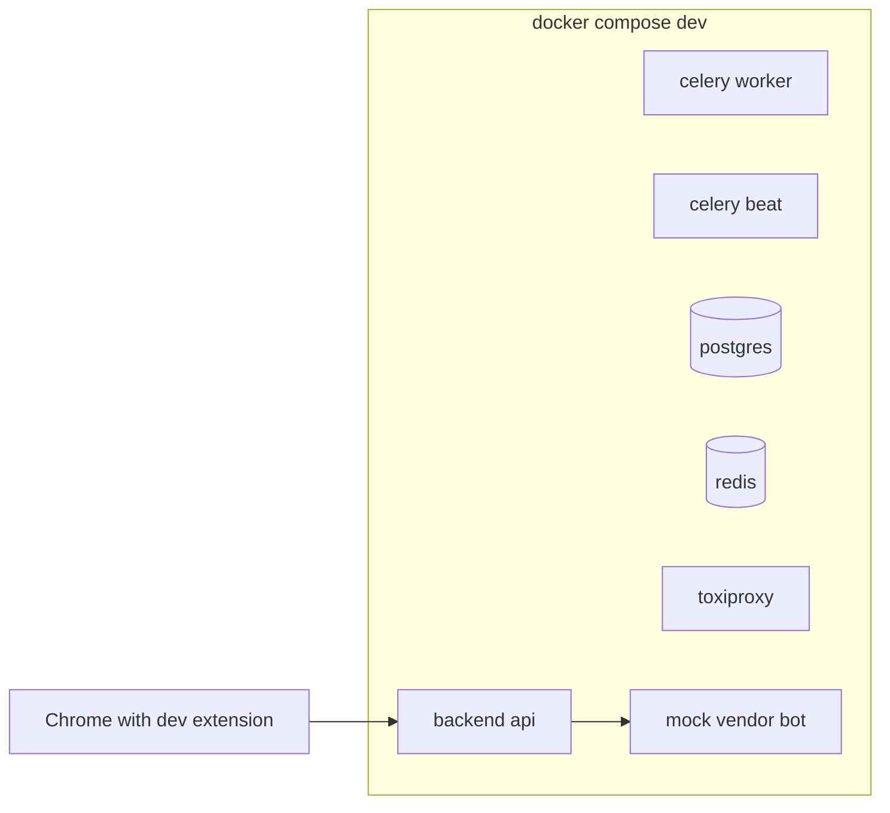
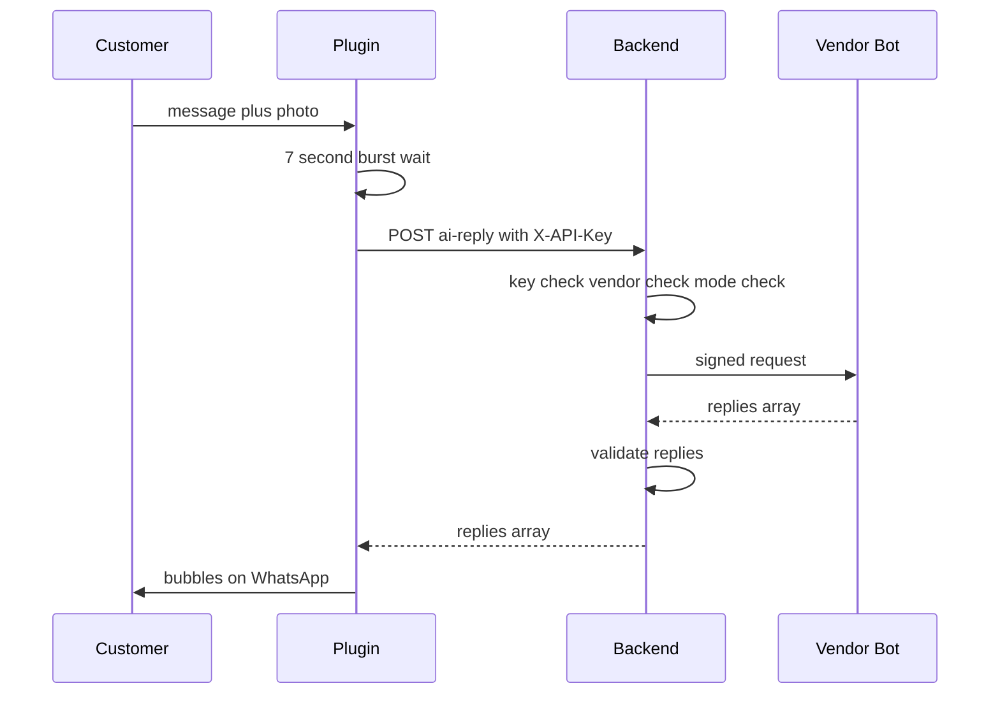
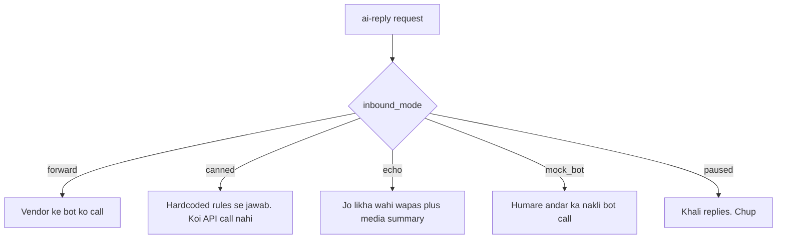
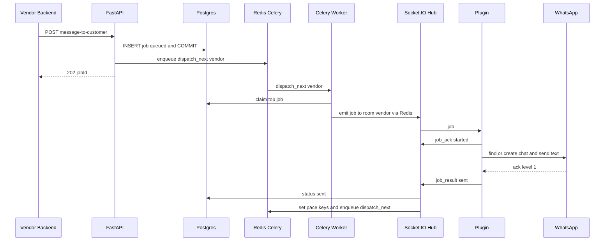
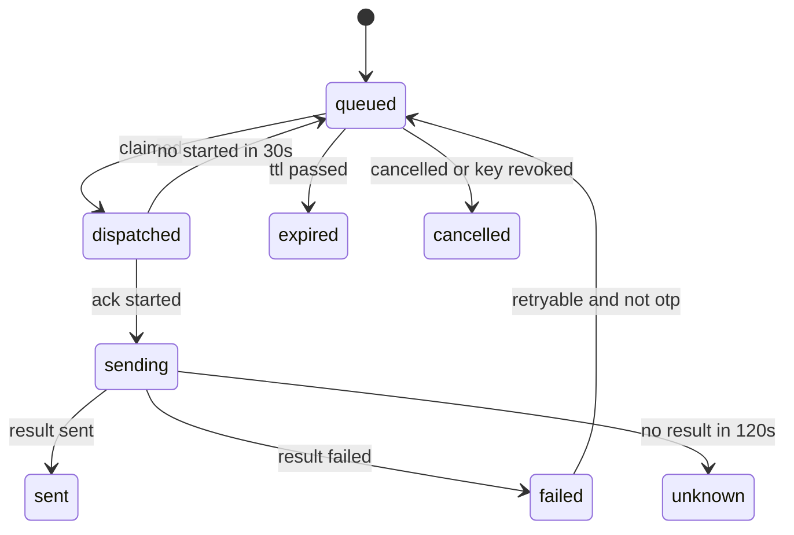
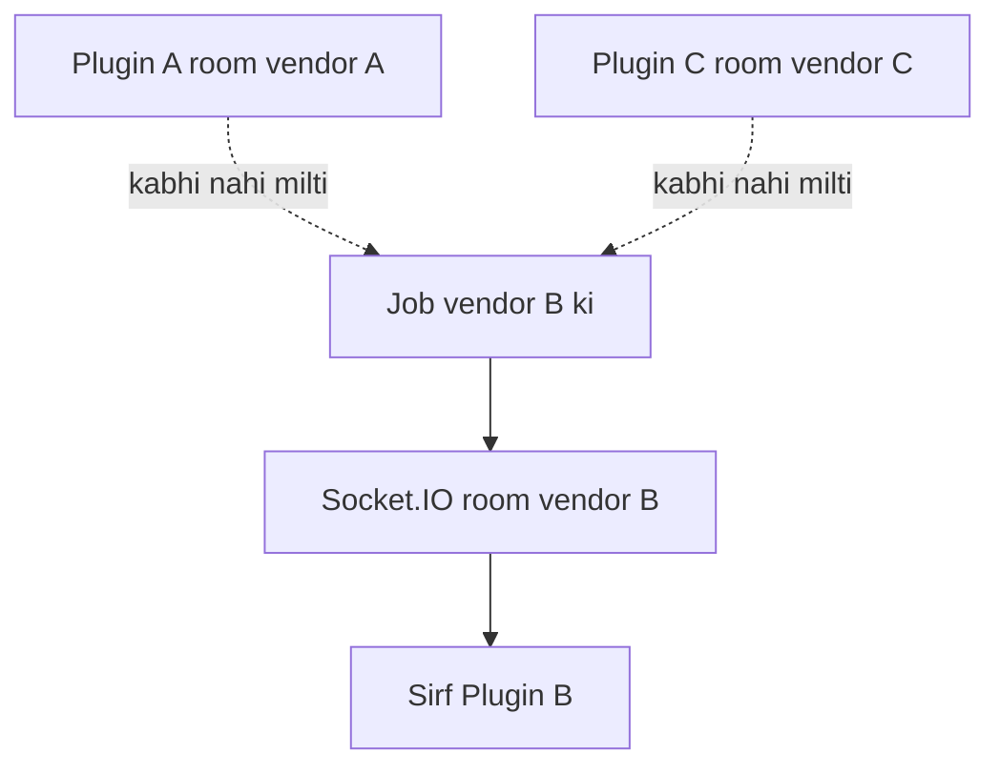
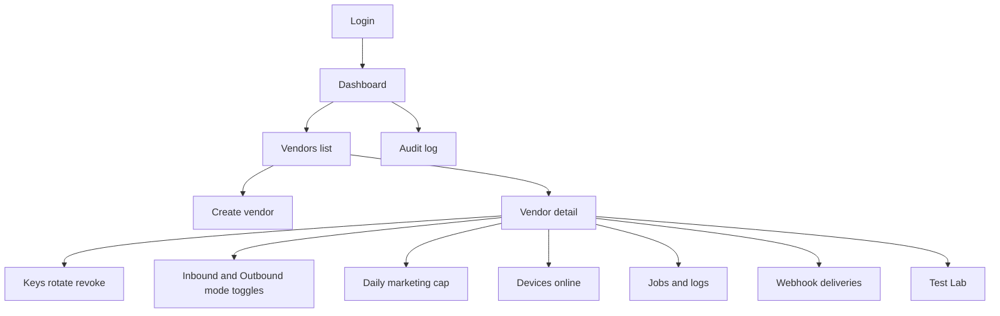
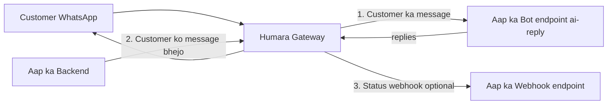
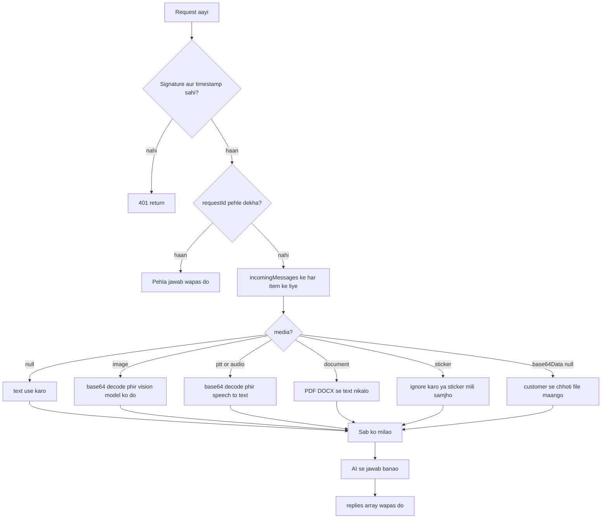

# Vendor Gateway + Plugin: Poora Plan (Roman Urdu, easy wording + samples)

Ek hi FastAPI project: gateway + Socket.IO realtime + Celery dispatch + admin panel (Jinja2/HTMX) + Test Lab (sandbox, canned replies, virtual plugin).

- **Phase 1:** plugin mein sirf X-API-Key, backend vendor ka bot call kare (inbound auto-reply).
- **Phase 2:** vendor `message-to-customer` API se customer ko message bheje (OTP / normal / marketing), backend job queue se plugin ko forward kare, plugin WhatsApp pe bheje.
- **Phase 3 (baad mein):** per-vendor concurrency cap, circuit breaker, templates, STOP/opt-out, vendor developer portal, official Cloud API channel (section 12.D aur 13 mein list).

Saath mein vendor contract (section 17, vendor ko bhejne wala), developer test guide (section 3.5), admin onboarding fields (section 9.1) aur worst-case test strategy.

---

## 0. Is plan ko kaise padhein

Har section mein pehle **"Simple baat"** hai (aam zabaan mein), phir **"Technical sample"** (code ya JSON ka namoona). Agar technical hissa samajh na aaye to sirf "Simple baat" padh lein, aur section 1.1 (technical cheezein easy mein) dekh lein.

**Is update mein kya badla (version 3):**
- **Outbound ab bilkul simple:** vendor sirf `number`, `message`, `type`, `ttlSeconds` bhejta hai. Plugin sirf text forward karta hai. Templates, Yes/No options, reply context sab **Phase 3** mein (section 12.D).
- **Concurrency cap aur circuit breaker abhi nahi** (over-engineering). Phase 3 mein.
- **Celery pacing clear:** job kaise pick hoti hai, gap kitna hai (1-2s ya 8-20s), Celery ko per vendor kaise pata chalta hai (section 8.3 aur 8.10).
- **Message types** (`otp`, `transactional`, `marketing`) ki poori table (section 8.1).
- **Developer test guide:** alag environments mein kaise test karein (section 3.5).
- **Admin onboarding fields** poori list ke saath (section 9.1).
- **Vendor contract** ek dedicated section 17 hai jo aap vendors ko abhi bhej sakte hain.
- **Section 1.1:** har technical cheez (Redis, Celery, Socket.IO, TTL, Idempotency-Key, HMAC...) easy example ke saath.

---

## 1. Badi tasveer

**Simple baat:** Backend ek **post office** hai. Plugin ek **courier** hai jo vendor ke WhatsApp ke paas baitha hai. Vendor ka bot **dukaan ka munshi** hai jo sawal ka jawab banata hai.



Do raaste:
1. **Inbound:** customer ne message kiya -> plugin -> backend -> vendor ka bot -> jawab -> plugin -> customer.
2. **Outbound:** vendor ne OTP bhejna hai -> backend -> job diary mein -> Celery -> Socket.IO -> plugin -> customer.

Teen kirdar ko kya pata hai:
- **Plugin** ko sirf API key pata hai. Bot URL nahi.
- **Backend** key se vendor pehchanta hai aur uska bot URL, secret, mode sab jaanta hai.
- **Vendor bot** sirf AI/business logic karta hai. WhatsApp ke baare mein usay kuch nahi pata.

### 1.1 Technical cheezein easy mein (glossary)

Jahan bhi ye alfaaz aayein, yahan wapas aa kar dekh lein.

**API key**
Hotel ki chaabi. Chaabi dekh kar hotel jaan jata hai ke ye room 305 wala hai. Humare system mein key dekh kar backend jaan jata hai ke ye "Ali Boutique" hai.
Example: `wab_live_k3f9a1xz_9fA83...`

**Database (Postgres)**
Ek **permanent register**. Vendor kaun hai, job kaunsi hai, kis status mein hai: sab yahan likha hota hai. Server band ho kar chale to bhi register wahin hai.

**Redis**
Ek **chhoti, bohot tez, temporary notebook** (RAM mein). Jahan wo cheezein jo thori der ke liye chahiye: "ye plugin abhi online hai", "agli job kab bhejni hai", "aaj kitni marketing gayi". Agar notebook gum ho jaye to bhi register (Postgres) se kaam wapas ban sakta hai.

**Celery**
Restaurant ka **waiter + kitchen**. API sirf parchi deti hai ("Ali ke liye check karo"). Celery worker parchi dekh kar kaam karta hai.
- **countdown:** parchi par alarm lagana. "2 second baad dobara check karo." Worker so kar intezar nahi karta, alarm baj'ne par task dobara chalta hai.
- **Celery Beat:** ek ghadi jo har 30 second ek chhoti safai/jaanch chalati hai (atki hui jobs pakadna).

**Socket.IO**
Ek **khuli rehne wali phone call** plugin aur server ke beech. Plugin har 2 second poochta nahi ke "kaam hai?", server jab chahe seedha bol deta hai.
- **Room:** WhatsApp group jaisa. `vendor:Ali` room mein sirf Ali ka plugin hota hai. Ali ki job sirf us room mein jati hai.

**Presence**
Redis mein ek chhoti slip: "Ali ka plugin abhi online hai". Ye 45 second baad khud expire ho jati hai, jab tak plugin heartbeat bhejta rahe tab tak taza rehti hai.

**Lease (meeyaad)**
Job ko plugin ko dene ke baad ek "meeyaad": "30 second mein tum kehna ke shuru kar di, warna job wapas queue mein". Agar plugin gum ho jaye to job atki nahi rehti.

**Outbox**
Plugin ka apna **chhota notebook**. Result pehle apne notebook mein likhta hai, phir server ko batata hai. Server "mil gaya" kahe tab hi notebook se mitaata hai. Internet chala jaye to result kho nahi jata.

**TTL (`ttlSeconds`)**
Dahi ki **expiry date**. OTP ka ttl 300 matlab 5 minute baad ye job bekaar hai. Plugin 2 ghante baad online ho to purana OTP kabhi nahi jayega.

**Idempotency-Key**
"Ek hi parchi do baar mat ginna." Example: vendor ne OTP API call ki, internet atka, usne wahi call 3 baar bheji. Agar teeno mein wahi `Idempotency-Key: otp-order-9981` ho to backend sirf ek job banata hai.

**HMAC signature (muhar)**
Backend vendor ko jo bhi request bhejta hai us par ek **muhar** lagata hai. Vendor muhar check kar ke yakeen karta hai ke request humse aayi, raaste mein badli nahi gayi, purani nahi hai. Poori detail section 17.A.5 mein.

**Unique index (DB ka rule)**
Database khud kehta hai "ek vendor ki ek hi job ek waqt mein 'bheji ja rahi' ho sakti hai". Agar koi dusri job bhi us status mein dalne ki koshish kare to database mana kar deta hai. Isse race condition (do workers ek saath) ka masla code pe nahi, database pe hal hota hai.

**Virtual plugin / Fake WhatsApp / Toxiproxy** (sirf testing ke liye)
- **Virtual plugin:** backend ke andar ka nakli plugin, WhatsApp ke baghair jobs lene wala.
- **Fake WhatsApp page:** nakli web.whatsapp.com page, extension ke automatic tests ke liye.
- **Toxiproxy:** dev/test mein network kharab karne wala tool (cut, slow, drop). Production mein nahi.

---

## 2. Assumptions

1. Ek key = ek WhatsApp number = ek Chrome profile. Ek vendor ke 2 numbers = 2 live keys.
2. Phase 1 mein dashboard/logging/contacts/poll sab band. Sirf inbound auto-reply.
3. Purana `server/` (Sara bot) sirf ek sample vendor bot hai. Naya project `Turabees-Whatsapp-Bot/backend/` mein banega.
   **Update (location):** Naya kaam `Turabees Whatsapp Bot V2/whatsup-plugin/` mein hai (`backend/`, `reference-bot/`, aur extension ki nayi copy `extension/`). Purana `Turabees-Whatsapp-Bot/` (Node.js) bilkul nahi chheda jata. Section 10 mein `Turabees-Whatsapp-Bot/extension/...` ke paths ab V2 wali `extension/` copy ke liye parhein.
4. Redis available hoga (Celery broker + Socket.IO manager + presence + pacing time + daily counter).
5. Plugin sirf **text** bhej sakta hai. Real tappable buttons, OTP copy-code buttons, image reply abhi scope mein nahi (section 12.D).
6. Outbound simple: `number`, `message`, `type`, `ttlSeconds`. Plugin sirf forward karta hai.

---

## 3. Environments aur Test Lab: vendors ke baghair kaise test hoga

**Simple baat:** Abhi koi vendor nahi hai, to hum khud har cheez ka nakli version banate hain. Phir poora system ek laptop pe, ek command se chal jata hai aur har worst case test ho sakta hai.

### 3.1 Environments

- `dev`: apna laptop. Localhost bot URL allowed. Mock bot on.
- `test`: automatic tests (CI). Containers real (Postgres, Redis, Toxiproxy).
- `staging`: asli server, ek asli test WhatsApp number. Mock bot on, localhost off.
- `prod`: sab sakht. Sirf public `https` bot URL. Mock bot off.

Config `APP_ENV` se chalta hai. Do khaas flags:

```text
ALLOW_PRIVATE_BOT_URLS = true     # sirf dev/test. Prod mein true hone par app start hi nahi hoti
ENABLE_MOCK_BOT        = true     # sirf dev/test/staging
```

Prod mein agar koi `true` kar de to startup check mein crash hoga (galti se production kholne se bachao).

### 3.2 Ek command se poora dev stack



```text
make dev-up      # sab containers
make seed        # 3 demo vendors + keys
make test        # unit + integration
make chaos       # network/crash tests
```

`make seed` ye banata hai (sab sandbox, localhost bot allowed):
- `demo-canned`: inbound_mode = canned (hardcoded jawab)
- `demo-echo`: inbound_mode = echo
- `demo-mockbot`: inbound_mode = mock_bot (poora contract follow karne wala nakli bot)

### 3.3 Dev extension build

Plugin ka `GATEWAY_BASE_URL` ek alag file `extension/config.js` mein hoga. Build script teen versions banata hai:

```text
node extension/build.mjs --env dev       # GATEWAY=http://localhost:8000, manifest mein localhost permission
node extension/build.mjs --env staging
node extension/build.mjs --env prod      # sirf prod origin, localhost permission hai hi nahi
```

Is se aap apne Number#01 aur Number#02 par asli WhatsApp Web ke saath, localhost backend se poora test kar sakte hain, aur prod build mein localhost ka koi nishaan nahi hota.

### 3.4 Test keys aur live keys (Stripe jaisa idea)

- `wab_live_...` key: asli plugin se jurti hai, asli WhatsApp message jata hai.
- `wab_test_...` key: koi asli WhatsApp message **nahi** jata. Outbound job **virtual plugin** (backend ke andar ka nakli plugin) handle karta hai.

Vendor developers ko pehle test key milti hai. Wo apni integration poori test kar lete hain, phir live key.

**Magic numbers (test key ke saath):** virtual plugin number ke aakhri hisse se behave karta hai:

```text
...0001   NOT_ON_WHATSAPP (failed)
...0002   pehli dafa WA_NOT_READY, dusri dafa sent
...0003   result kabhi nahi aata (unknown)
...0004   30 second slow phir sent
baqi      1 se 3 second mein sent
```

Yani vendor ka code "number WhatsApp pe nahi" wale case ko bhi bina asli number ke test kar sakta hai.

### 3.5 Developer test guide: alag alag environment mein kaise test karein

Ye section developer (aap ya aap ki team) ke liye step-by-step hai. Sab easy order mein.

#### Step A: Apne laptop pe sab chalao (`dev`)

```text
1. make dev-up        # backend + postgres + redis + celery + mock bot start
2. make seed          # 3 demo vendors aur unki keys ban jati hain
3. Admin panel kholo: http://localhost:8000/admin  (seed ka admin login)
```

#### Step B: Pehla test, bina bot ke (sab se aasan)

Maqsad: plugin + gateway + WhatsApp send sab theek hain ya nahi.

```text
1. node extension/build.mjs --env dev   -> dist/dev bana
2. Chrome > Extensions > Load unpacked > dist/dev
3. web.whatsapp.com par apna Number#01 login
4. Popup mein demo-canned ki LIVE key paste > Save
   "Connected as demo-canned" dikhna chahiye
5. Doosre phone (Number#02) se Number#01 ko "hello price" likho
6. 7 second baad Number#01 se hardcoded jawab aana chahiye
```

Agar jawab aaya: **plugin, key, backend, WhatsApp send sab theek**.

#### Step C: Apna bot localhost pe

```text
1. Apna bot localhost:9000/ai-reply par chalao (ya hamari reference bot: `make bot`, section 7.5)
2. Admin > Vendor > bot_base_url = http://localhost:9000 (dev mein allowed)
3. inbound_mode = forward
4. Number#02 se message likho > bot ka jawab WhatsApp pe aana chahiye
5. Bot band karo / galat JSON do > WhatsApp pe kuch nahi aayega (design ke mutabiq),
   popup mein "Last error" aur Admin > Request logs mein wajah dikhegi
```

#### Step D: Bina WhatsApp ke bot test (Test Lab)

```text
Admin > Test Lab > Simulate incoming
  text likho / image upload karo > Send
Neeche dikhega: bot ko gayi request, signature headers, bot ka jawab, latency, validation errors
```

Ya vendor developer khud (test key se): `POST /v1/sandbox/simulate-incoming`.

#### Step E: Outbound test

```text
Option 1 (bina WhatsApp): TEST key + magic numbers
  POST /v1/message-to-customer  X-API-Key: wab_test_...
  { "number": "923000000001", "message": "hi", "type": "otp", "ttlSeconds": 300 }
  -> virtual plugin NOT_ON_WHATSAPP wala status dega

Option 2 (asli WhatsApp): LIVE key + plugin chalta hua
  { "number": "<Number#02>", "message": "Aap ka OTP 482913 hai.", "type": "otp", "ttlSeconds": 300 }
  -> Number#02 ke phone pe asli message aayega
```

#### Step F: Automatic tests (CI / laptop)

```text
make test     # unit + integration + signature tests
make chaos    # Toxiproxy: internet cut, slow, flapping
npx playwright test    # extension + fake WhatsApp
```

#### Step G: Staging (asli server, ek asli test number)

- Extension `--env staging`, staging ki LIVE key.
- Mock bot on, localhost bot **off** (bot URL public https hona chahiye).
- Section 14.12 ka manual checklist (WiFi off, laptop sleep, linked device hatana) yahin chalao.

#### Step H: Prod

- Extension `--env prod`: localhost permission hai hi nahi.
- Mock bot off, test keys sirf vendors ke integration testing ke liye.
- Pehle ek chhota pilot vendor, phir baaki.

**Ek table mein summary:**

| Env | Kahan | Bot URL localhost? | Test Lab / mock | Asli WhatsApp |
|---|---|---|---|---|
| dev | laptop | Haan | Haan | Optional (dev build) |
| test | CI | Haan | Auto tests | Fake WhatsApp page |
| staging | server | Nahi | Haan | 1 test number |
| prod | server | Nahi | Mock off | Haan |

---

## 4. API key: kaise banti hai, kaise check hoti hai

**Simple baat:** Key hotel ki chaabi hai. Hum chaabi kisi ko dikhate hain sirf ek dafa. DB mein sirf uska "fingerprint" rakhte hain.

**Technical sample:**

```python
import hashlib, hmac, secrets

def generate_api_key(kind: str = "live") -> tuple[str, str, str]:
    prefix = secrets.token_hex(4)               # 8 chars: DB mein dhoondne ke liye
    secret = secrets.token_urlsafe(32)          # asli raaz
    full_key = f"wab_{kind}_{prefix}_{secret}"  # kind = live ya test
    key_hash = hashlib.sha256(full_key.encode()).hexdigest()
    return full_key, prefix, key_hash           # full_key sirf ek baar dikhao

def verify_api_key(full_key: str, stored_hash: str) -> bool:
    candidate = hashlib.sha256(full_key.encode()).hexdigest()
    return hmac.compare_digest(candidate, stored_hash)   # == nahi, constant-time
```

Lambi random key ke liye SHA-256 kaafi hai (password jaisa bcrypt zaroori nahi, kyun ke key guess karna namumkin hai).

FastAPI mein auth ek "dependency" hai, har route par laga do:

```python
async def get_auth(x_api_key: str = Header(...), db: AsyncSession = Depends(get_db)) -> AuthContext:
    parts = x_api_key.split("_", 3)             # ["wab","live","k3f9a1xz","secret..."]
    if len(parts) != 4 or parts[0] != "wab":
        raise ApiError(401, "INVALID_KEY")
    row = await keys.find_active_by_prefix(db, parts[2])
    if not row or not verify_api_key(x_api_key, row.key_hash):
        raise ApiError(401, "INVALID_KEY")
    vendor = await vendors.get(db, row.vendor_id)
    if vendor.status != "active":
        raise ApiError(403, "VENDOR_SUSPENDED")
    return AuthContext(vendor=vendor, key=row)   # key.kind = live/test
```

Rules: key sirf header mein (URL ya log mein kabhi nahi), galat key par IP-wise rate limit, revoke par socket foran band, plugin mein `chrome.storage.local` (sync mein nahi).

---

## 5. Database (Postgres)

**Simple baat:** Database ek **diary** hai. Har table ek register.

```sql
vendors(
  id uuid pk, business_name, phone_e164, email,
  bot_base_url, bot_secret_enc,            -- secret ENCRYPTED (signing ke liye wapas padhna padta hai)
  status default 'active',                 -- active / suspended
  inbound_mode default 'forward',          -- forward / canned / echo / mock_bot / paused
  outbound_mode default 'real_plugin',     -- real_plugin / paused
  status_webhook_url, webhook_secret_enc,
  default_country_code default '92',
  marketing_daily_cap int default 200,     -- admin se per vendor
  internal_note,
  created_at)
api_keys(id, vendor_id, kind, key_prefix unique, key_hash, status, last_used_at, created_at, revoked_at)
canned_rules(id, vendor_id, priority, match_type, match_value, reply_text)   -- Test Lab

-- Phase 2
devices(id, vendor_id, device_id, wa_number, plugin_version, last_seen_at)
outbound_jobs(
  id, vendor_id, is_test bool,
  to_number, body,                 -- body = vendor ka bheja hua "message" (bas wahi text)
  type,                            -- otp / transactional / marketing
  priority smallint,               -- otp 9, transactional 5, marketing 0
  status, attempts, idempotency_key,
  available_at, ttl_expires_at, lease_expires_at,
  sent_at, wa_ack smallint, error_code, created_at)
webhook_deliveries(id, vendor_id, event_id, event, payload, status, attempts, next_attempt_at)
request_logs(id, vendor_id, request_id, kind, status, latency_ms, error_code, created_at)  -- body NAHI
admins(id, email, password_hash, role, totp_secret_enc)
audit_log(id, admin_id, action, target, created_at)

-- Phase 3 (baad mein, abhi nahi banana):
-- message_templates, reply_contexts, suppressions (STOP/opt-out)
```

Zaroori constraints:

```sql
unique (vendor_id, idempotency_key);

-- ek vendor ki ek hi job ek waqt mein "bheji ja rahi" ho sakti hai
CREATE UNIQUE INDEX one_inflight_per_vendor
ON outbound_jobs (vendor_id) WHERE status IN ('dispatched','sending');
```

**Ye "ek job ek waqt mein" ka matlab:** baqi jobs `queued` mein intezar karti hain (drop nahi hotin). Ek khatam ho to agli uthti hai.

**Sample rows (jobs table, alag alag status):**

```text
id       vendor  to_number     type   status      attempts  ttl_expires   error
job_01   Ali     923486102017  otp    sent        1         19:05:00      -
job_02   Ali     923001112222  mkt    queued      0         next day      -
job_03   Ali     923331112233  otp    expired     0         19:05:00      -
job_04   Zara    923451234567  trans  sending     1         19:30:00      -
job_05   Ali     923000000001  otp    failed      1         19:05:00      NOT_ON_WHATSAPP
job_06   Zara    923458889999  otp    unknown     1         19:30:00      NO_RESULT
```

Secrets (`bot_secret`, `webhook_secret`) hash nahi ho sakte (signing ke liye asli value chahiye), is liye **encrypt** karke rakhte hain (Fernet, key environment variable mein).

---

## 6. Phase 1: Inbound (customer message karta hai)

**Simple baat:** Customer Sara ne Ali Boutique ko "Red lehenga available hai?" likha aur photo bheji. Plugin pakadta hai, 7 second ruk kar jama karta hai, backend ko deta hai. Backend key se Ali ko pehchanta hai aur Ali ke bot se jawab laata hai.



**Plugin ki request:**

```text
POST https://api.ourcompany.com/v1/ai-reply
X-API-Key: wab_live_k3f9a1xz_...
X-Device-Id: 5d2e...        X-WA-Number: 923001234567
X-Request-Id: 8f2c...       X-Contract-Version: 1
```

**Teen check ka matlab (key check / vendor check / mode check):**
1. **Key check:** `X-API-Key` sahi hai? Nahi to 401.
2. **Vendor check:** vendor active hai? plugin ka WhatsApp number vendor ke registered number se milta hai? Nahi to 403.
3. **Mode check:** vendor ka `inbound_mode` kya hai? (forward / canned / echo / mock_bot / paused) mode ke hisab se aage ka raasta.

**Backend ke steps (FastAPI sketch):**

```python
@router.post("/v1/ai-reply")
async def ai_reply(request: Request, auth: AuthContext = Depends(get_auth)):
    raw = await read_body_limited(request, max_bytes=40 * 1024 * 1024)   # 413 agar bada
    payload = AiReplyRequest.model_validate_json(raw)

    check_wa_number(auth.vendor, request.headers.get("X-WA-Number"))      # galat profile pakdo

    mode = auth.vendor.inbound_mode
    if mode == "paused":
        return {"replies": []}
    if mode == "canned":
        return {"replies": canned.pick(auth.vendor.id, payload)}
    if mode == "echo":
        return {"replies": echo.make(payload)}
    url = mock_bot_url(auth.vendor) if mode == "mock_bot" else auth.vendor.bot_base_url + "/ai-reply"

    result = await bot_proxy.call(auth.vendor, url, payload)              # httpx + SSRF + sign + timeout
    return {"replies": validate_replies(result)}
```

**Plugin ke saath safety:** plugin ko `401/403/5xx/timeout` mile to wo **customer ko kuch nahi bhejta** (automatic "technical issue" message customer ko ajeeb lagta hai), popup mein "Last error" dikhata hai, aur dobara request nahi karta (duplicate jawab ka khatra).

### 6.1 Bot ko call karte waqt hifazat (SSRF)

**Simple baat:** Agar vendor bot URL mein `http://localhost` ya andar ka IP daal de, to hamara backend apne andar ki cheezein khol ke de sakta hai (hacker ka tareeqa). Isliye URL check hota hai.

```python
def validate_bot_url(url: str) -> None:
    u = urlparse(url)
    if settings.allow_private_bot_urls:         # sirf dev/test
        return
    if u.scheme != "https":
        raise ApiError(400, "BOT_URL_MUST_BE_HTTPS")
    ip = resolve_to_ip(u.hostname)              # DNS resolve
    if ipaddress.ip_address(ip).is_private or is_loopback or is_link_local:
        raise ApiError(400, "BOT_URL_NOT_ALLOWED")
    # connect usi resolved ip par karo (DNS rebinding se bachne ke liye), redirects follow nahi
```

Prod mein localhost reject, dev mein allowed.

### 6.2 Plugin se hatayi jaane wali cheezein

Dashboard, contacts sync, `/log-message`, aur wo `poll-commands` jo har 1.5 second server ko pooch raha tha. Warna URL badalte hi vendor ke server pe spam jayega aur customers ki contact list unhein chali jayegi.

### 6.3 Phase 1 worst cases

- Key galat/khali -> plugin pause, popup message, spam nahi.
- Vendor suspended -> 403, plugin pause.
- Bot down/slow/invalid JSON -> backend 502/504, customer ko kuch nahi.
- `replies: []` -> chup raho.
- Bohot bada media -> 413 ya `base64Data: null`.
- Backend down -> plugin silent, "Backend offline".
- Same key do profiles -> Phase 1 mein warning log, Phase 2 mein strict.
- **Abhi nahi (Phase 3):** per-vendor concurrency cap aur circuit breaker. Abhi har request normal bot ko forward hoti hai. Agar ek vendor ka bot bohot slow ho to sirf us ki requests lambi chalti hain; isko over-engineering maan kar baad mein add karenge.

---

## 7. Sandbox modes aur Test Lab (Phase 1B)

**Simple baat:** Admin panel mein har vendor ke liye ek **toggle** hota hai: "bot ko call karo ya nahi". Test Lab mein bina WhatsApp ke bhi message simulate kar sakte hain.

### 7.1 Inbound mode (vendor page pe dropdown)



- **forward:** asli mode.
- **canned:** "mera server koi API call na kare, har message ka hardcode jawab de". Rules likh sakte hain:

```text
Rule 1: text contains "price"   -> "Price 85,000 se shuru hota hai."
Rule 2: media_type = image      -> "Photo mil gayi, jaldi dekhte hain."
Rule 3: media_type = ptt        -> "Voice note mila, text mein likh dein?"
Default                          -> "Shukriya! Hum jald jawab denge."
```

- **echo:** `"Aap ne likha: Red lehenga available hai? (1 image, 14 KB)"`. Ye dikhata hai ke data sahi pohancha, bina bot ke.
- **mock_bot:** poora contract follow karne wala nakli bot (signature verify karta hai) ke saath scenarios: `ok`, `slow` (40s), `error500`, `badjson`, `empty`, `huge`, `redirect`, `wrongshape`. Isse hum **apni** failure handling test karte hain.
- **paused:** kill switch. Customers ko jawab nahi jata.

Warning: live vendor par `canned` lagana asli customers ko hardcoded jawab dega. UI confirm maangta hai.

### 7.2 Test Lab ke pages (admin panel mein)

- **Simulate incoming:** form: vendor chuno, text likho, image/audio/PDF upload karo, "Send". Backend wohi pipeline chalata hai jo plugin ki request par chalti hai (WhatsApp ke baghair). Result page dikhata hai:
  - bot ko gayi hui request (media redacted, size dikhao)
  - headers (signature, timestamp)
  - bot ka jawab, status, latency
  - validation errors (jaise "replies string hai, array chahiye")
- **Bot connection test:** vendor ke bot ko ek sample signed request bhejo, pass/fail dikhao (onboarding ke waqt zaroori).
- **Send test outbound:** test key se message-to-customer; virtual plugin handle karta hai.
- **Request logs:** har request ka status, latency, error code (body kabhi nahi, sirf sandbox vendors ke liye optional "capture payloads" toggle).

Vendors ke liye bhi (test key ke saath):

```text
POST /v1/sandbox/simulate-incoming      # backend aap ke bot ko call karta hai, jawab + validation report wapas
POST /v1/message-to-customer            # test key => virtual plugin, magic numbers
```

Is se vendor team bina WhatsApp ke apna bot contract khud test kar leti hai.

### 7.3 Virtual plugin (nakli plugin)

Backend ke saath ek chhota Socket.IO client aata hai jo asli plugin ki tarah behave karta hai (connect, heartbeat, job receive, ack, result), lekin WhatsApp nahi chhoota. Isko tests mein aur test keys ke liye use karte hain. Behavior configurable hai: delay, "result mat bhejo", "beech mein disconnect ho jao".

### 7.4 Fake WhatsApp page (extension ke automatic tests ke liye)

Ek nakli `web.whatsapp.com` page jis mein asli WhatsApp jaise internal functions ke stubs hain (message aana, send, connection state, ack). Control API:

```text
fake.deliverIncoming({chat, text, media})
fake.setConnState('connected' | 'offline' | 'logged_out')
fake.setAckDelay(ms | 'never')
fake.rejectSend()
```

Real Chrome mein extension load karke isko order dete hain ("ab offline ho jao") aur plugin ka behavior check karte hain, WhatsApp ke baghair.

**Kya ye asli number pe test karta hai?** Nahi. Fake page pe numbers bhi mock hote hain. Isse pata chalta hai "plugin ne sahi number pe send function call kiya", lekin asli phone pe message nahi aata. Asli delivery ke liye real WhatsApp (staging number) chahiye (section 3.5 Step B/E).

### 7.5 Reference bot (FastAPI): hamara apna test chatbot

Jab tak vendor ka asli bot na aaye, ye chhota bot `localhost:9000/ai-reply` par chalta hai. Ye **FastAPI** mein hai (koi Node.js nahi), aur vendor contract (section 17.A) ko poora follow karta hai. Jawab simple hota hai ("Aap ne likha: ..." + media ka summary), koi AI nahi.

```text
reference-bot/
  app/
    main.py        FastAPI app: POST /ai-reply, GET /health
    config.py      pydantic-settings: BOT_SECRET, PORT (9000), MAX_SKEW_SECONDS (300)
    security.py    HMAC verify, 300s timestamp tolerance, constant-time compare
    schemas.py     pydantic models: text/image/audio/document/ptt, base64Data null (bari file), response { "replies": [...] }
    handlers.py    simple jawab banane ka logic
  tests/           pytest: sahi/galat signature, purani timestamp, har media type, bari file
  pyproject.toml   dependencies + ruff + mypy config
  Dockerfile
  README.md
```

- `docker-compose` mein `reference-bot` service, aur `make bot` command.
- Ye backend ke andar ke `mock_bot` mode (7.1) se alag hai: `mock_bot` backend ka hissa hai (failure scenarios ke liye), reference bot alag chalne wala app hai (forward mode ke asli raaste ke liye).

---

## 8. Phase 2: Outbound (vendor customer ko khud message bheje)

### 8.1 Vendor ki API call (simple structure)

**Simple baat:** Ali ki website ne OTP bhejna hai. Wo hamari API call karta hai, hum job diary mein likh dete hain, aur turant "mil gaya" keh dete hain. Plugin ko hum sirf wahi text forward karte hain jo vendor ne bheja.

```text
POST /v1/message-to-customer
X-API-Key: wab_live_...
Idempotency-Key: otp-order-9981      (OTP ke liye zaroori)
Content-Type: application/json
```
```json
{
  "number": "03486102017",
  "message": "Aap ka OTP 482913 hai.",
  "type": "otp",
  "ttlSeconds": 300
}
```

Response (HTTP 202):

```json
{ "success": true, "jobId": "job_7f3a", "status": "queued", "channelOnline": true }
```

**Chaaron fields ka matlab:**
- `number`: customer ka number, kisi bhi format mein. `03486102017` -> `923486102017`, `+92 348 6102017` aur `0092...` bhi theek. 10 se 15 digits ke bahar ya letters = `400 INVALID_NUMBER`.
- `message`: poora text jo customer ko jayega. Max 4000 characters. Plugin ise **bina badle** WhatsApp pe bhejta hai.
- `type`: neeche table dekho. Isi se priority, gap, retry, daily cap tay hoti hai.
- `ttlSeconds`: is message ki zindagi. Is se zyada der queue mein rahi to `expired`, kabhi nahi jayegi. Na bhejo to type ka default.

**Header `Idempotency-Key`:** vendor ne wohi request 3 dafa bheji to ek hi job, ek hi OTP. Same key dobara = wahi `jobId` (HTTP 200). OTP ke liye zaroori.

**`channelOnline`:** abhi plugin online hai ya nahi (vendor ko pata chale). Offline ho tab bhi job queue mein ban jati hai (202).

### 8.1.1 Types: kaun kaun si hain aur kis mein kya hota hai

```text
type            Kis ke liye                      Priority  Gap(do jobs ke beech)   TTL default  Daily cap    Fail pe retry
-----------------------------------------------------------------------------------------------------------------------
otp             login/verification code          9 (sab    1-2 second              300 (5 min)  nahi lagta   nahi (duplicate OTP
                                                  se upar)                                                     ka khatra)
transactional   order confirm, delivery, bill   5 (beech) 1-2 second              3600 (1 ghanta) nahi lagta  retryable errors par
                                                                                                               chhote retry
marketing       offer, sale, promo               0 (sab se 8-20 second (random)   86400 (1 din) admin ka       pacing + daily cap
                                                  neeche)                                      marketing cap  ke andar
```

- Agar vendor `type` na bheje: default `transactional`.
- `ttlSeconds` ki hadd: minimum 30, maximum 86400. Is se bahar ho to clamp (30 ya 86400).
- Daily cap (default 200, admin per vendor) **sirf marketing** pe lagta hai, OTP/transactional pe nahi, taa ke OTP kabhi block na ho.

**Example (priority ka asar):** Ali ne ek saath bheje: marketing, marketing, OTP.

```text
Queue: [marketing#1, marketing#2, OTP]   (aane ka order)
Bhejne ka order: OTP -> (1-2s) -> marketing#1 -> (8-20s) -> marketing#2
```

### 8.2 Poora flow



**Pehle diary, phir parchi:** pehle job DB mein commit hoti hai, phir Celery ko "jaag jao" ka signal jata hai. Agar signal kho jaye to Celery Beat (har 30s) pakad leta hai (8.5).

**Plugin ko kya milta hai (simple forward):**

```json
{ "jobId": "job_7f3a", "attempt": 1, "to": "923486102017",
  "message": "Aap ka OTP 482913 hai.", "type": "otp", "expiresAt": "2026-10-30T19:05:00Z" }
```

Plugin sirf `to` aur `message` WhatsApp pe bhejta hai. `type` sirf log/UI ke liye hai.

### 8.3 Celery kaise job pick karta hai (per vendor) aur time kaise pata chalta hai

**Simple baat:** Celery ko "is vendor ki job abhi gayi hai, ab 2 second baad" ka pata **do jagah se** chalta hai:
1. Task ka naam aur argument: `dispatch_next(vendor_id)`. Har task **sirf ek vendor** ke liye hota hai, kabhi "sab vendors" nahi.
2. Redis mein har vendor ke liye **do chhote time-stamp**: "jaldi wali job kab ja sakti hai" aur "marketing kab ja sakti hai".

**Redis keys (per vendor):**

```text
pace:vendor:{vendor_id}:fast   = unix time, is waqt tak otp/transactional ruke
pace:vendor:{vendor_id}:slow   = unix time, is waqt tak marketing ruke
wake:vendor:{vendor_id}        = unix time, is vendor ka agla "dobara dekho" alarm kab bajega
```

(Teeno keys 60 second baad khud expire ho jati hain. Agar Redis se gum ho jayein to koi nuksan nahi, bas ek dafa gap ke baghair agli job chali jati hai.)

**Jab ek job complete hoti hai (`job_result` aaya):**

```python
# Socket.IO job_result handler ke andar (API process)
now = time.time()
redis.set(f"pace:vendor:{vid}:fast", now + random.uniform(1, 2),  ex=60)    # otp/transactional gap
redis.set(f"pace:vendor:{vid}:slow", now + random.uniform(8, 20), ex=60)    # marketing gap
dispatch_next.delay(vid)        # "is vendor ke liye dobara dekho"
```

Matlab har job ke baad **dono gap** set hote hain. Phir jo agli job aati hai wo apni type ka gap dekhti hai.

**`dispatch_next(vendor_id)` ka kaam (ek vendor ke liye):**

```python
@celery_app.task(bind=True, acks_late=True, queue="dispatch", soft_time_limit=20)
def dispatch_next(self, vendor_id: str):
    with SessionLocal() as db:
        if not presence.is_online_and_wa_connected(vendor_id):
            return "offline"                          # job queued hi rahegi, plugin aate hi dispatch_next chalega

        top = peek_next_job(db, vendor_id)            # sirf dekho: priority DESC, created_at ASC
        if top is None:
            return "empty"

        lane = "slow" if top.type == "marketing" else "fast"
        wait = redis_wait_seconds(f"pace:vendor:{vendor_id}:{lane}")   # kitni der aur rukna hai
        if wait > 0:
            schedule_wake(vendor_id, delay=wait)      # ALARM: wait ke baad dobara dispatch_next(vendor_id)
            return "paced"

        try:
            job = claim_job(db, top.id)               # UPDATE status='dispatched' (SKIP LOCKED)
        except IntegrityError:                        # one_inflight_per_vendor: abhi ek job chal rahi hai
            return "busy"

        emitter.emit("job", job_payload(job), room=f"vendor:{vendor_id}")
        check_lease.apply_async(args=[str(job.id), job.attempts], countdown=30)
```

**`schedule_wake` ka chhota qaida (ek vendor ke liye ek hi alarm):**

```python
def schedule_wake(vendor_id, delay):
    wake_at = time.time() + delay
    existing = float(redis.get(f"wake:vendor:{vendor_id}") or 0)
    if existing and existing <= wake_at:
        return                                         # pehle se ek jaldi ya barabar alarm laga hai, dobara mat lagao
    redis.set(f"wake:vendor:{vendor_id}", wake_at, ex=int(delay) + 10)
    dispatch_next.apply_async(args=[vendor_id], countdown=delay)
```

Is qaide ka faida: Ali ne 100 marketing API se bhejin to 100 alarm nahi lagte, sirf ek lagta hai.

**Ek chhota example (Ali, vendor A):**

```text
10:00:00.0  OTP#1 bheji. job_result aaya.
            fast = 10:00:01.5, slow = 10:00:12.0
10:00:00.1  dispatch_next(A): top = marketing#1, slow ke liye 11.9s baki
            -> alarm 10:00:12 pe lagaya, task khatam
10:00:03.0  Ali ne OTP#2 bheja. API -> dispatch_next(A)
            top = OTP#2 (priority), fast (10:00:01.5) guzar chuka, wait 0
            -> OTP#2 claim, plugin ko bhej di
            job_result ke baad fast = 10:00:04.5, slow = 10:00:15 (naya)
10:00:15    alarm baja: dispatch_next(A): marketing#1 chal gayi
```

OTP ko marketing ke gap ka intezar nahi karna padta. Isi liye do alag keys hain.

**Ab 10 vendors:**

```text
A: dispatch_next("A") + Redis pace:vendor:A:*  ->  apni line
B: dispatch_next("B") + Redis pace:vendor:B:*  ->  apni line
...
J: dispatch_next("J") + Redis pace:vendor:J:*  ->  apni line
```

- Har vendor ke keys alag, har vendor ka task alag. A ka 12s wait B ko rokta nahi.
- Multiple Celery workers ek saath chal sakte hain, har task ek vendor ke liye.
- Ek vendor ke liye kabhi do job ek waqt mein nahi jati (DB unique index "busy" kehta hai).

**Worker `sleep()` nahi karta:** wait ke liye Celery ka `countdown` (alarm) lagta hai. Worker foran free ho jata hai aur dusre vendors ka kaam kar sakta hai. Countdown sirf seconds ka hai (20s tak), is liye Redis broker ke saath masla nahi.

**Daily cap alag cheez hai:** marketing 200/day (section 8.10) ka counter alag Redis key hai, gap se nahi milta.

Kyun ye safe hai:
- `dispatch_next` do baar chal jaye to koi nuksan nahi (claim atomic, "busy"/"paced" return).
- Worker alag process hai, wo seedha socket ko nahi bol sakta. Isliye Socket.IO ka **Redis manager (write-only)** use hota hai: worker Redis pe likhta hai, API process wahan se plugin tak pohancha deta hai.

Celery settings: `acks_late=True`, `reject_on_worker_lost=True`, `prefetch_multiplier=1`, result backend nahi (DB status kaafi hai), queues: `dispatch`, `maintenance`, `webhooks`.

### 8.4 Socket.IO: khuli rehne wali phone line

**Simple baat:** Plugin har 2 second poochta ke "koi kaam hai?" to hazaron plugins server ko tang karte. Socket.IO mein plugin ek dafa call lagata hai, line khuli rehti hai, server jab chahe bol deta hai.

**Rooms:** Ali ka plugin `vendor:Ali` room mein, Zara ka `vendor:Zara` mein. Ali ki job sirf Ali ke room mein jati hai.

```python
sio = socketio.AsyncServer(
    async_mode="asgi",
    client_manager=socketio.AsyncRedisManager(REDIS_URL),
    ping_interval=20, ping_timeout=15,
    cors_allowed_origins=[EXTENSION_ORIGIN],
)

@sio.event
async def connect(sid, environ, auth):
    ctx = await authenticate_socket(auth)       # key, vendor active, waNumber vendor ke number se match
    if ctx is None:
        raise socketio.exceptions.ConnectionRefusedError("INVALID_KEY")
    ok = await presence.claim(ctx.vendor_id, sid, device_id=auth["deviceId"])
    if not ok:
        raise socketio.exceptions.ConnectionRefusedError("SESSION_ALREADY_ACTIVE")
    await sio.save_session(sid, {"vendor_id": ctx.vendor_id})
    await sio.enter_room(sid, f"vendor:{ctx.vendor_id}")
    dispatch_next.delay(ctx.vendor_id)          # catch-up: jo jobs ruki thin ab bhejo

@sio.event
async def job_result(sid, data):
    s = await sio.get_session(sid)
    await jobs.apply_result(s["vendor_id"], data)   # job is vendor ki hai? warna reject. Duplicate? idempotent.
    return {"ok": True}                             # ye plugin ko ACK ke tor par milta hai
```

**Events (JSON):**

```json
server -> plugin  "job":        { "jobId": "job_7f3a", "attempt": 1, "to": "923486102017",
                                   "message": "Aap ka OTP 482913 hai.", "type": "otp",
                                   "expiresAt": "2026-10-30T19:05:00Z" }
plugin -> server  "job_ack":    { "jobId": "job_7f3a", "attempt": 1, "stage": "started" }
plugin -> server  "job_result": { "jobId": "job_7f3a", "attempt": 1, "status": "sent", "waAck": 1 }
plugin -> server  "job_result": { "jobId": "job_7f3a", "attempt": 1, "status": "failed", "errorCode": "NOT_ON_WHATSAPP" }
plugin -> server  "heartbeat":  { "waState": "connected", "queueLength": 0, "sendingJobId": null }
```

**Ek key = ek active session (presence):**
- Redis: `SET presence:vendor:{id} <sid>|<deviceId> NX EX 45` (heartbeat se refresh).
- Dusra connection **alag device** se aaye aur pehla zinda ho -> `SESSION_ALREADY_ACTIVE` (reject).
- Pehla mar chuka (key expire) -> naya accept.
- **Same deviceId** se reconnect (plugin ka internet jhapka, server ko abhi pata nahi chala) -> foran **takeover**, purana sid disconnect. Warna flapping network mein plugin khud ko hi 45 second tak reject karta rehta.

**`X-Device-Id` kya hai:** plugin install ka random UUID (`chrome.storage.local` mein). Ye recipient number nahi hai. Ye sirf "kaunsa Chrome install connected hai" batata hai. Koi storage edit kar sake to isay secret mat samjho. Asli security API key hai.

**Connect pe waNumber check:** plugin batata hai "main 923001234567 mein login hoon". Vendor ke registered number se na mile to connection reject. Galat profile se OTP jaane ka khatra khatam.

**Service worker (MV3) ki dikkat aur hal:** Chrome extension ka background worker so jata hai aur socket saath mar jata hai. Hal: Chrome 116+ mein socket pe 30s ke andar traffic ho to worker zinda rehta hai (is liye ping 20s), plus `chrome.alarms` har 30s `ensureConnected()` chalata hai. **Sirf `websocket` transport** (MV3 worker mein long-polling nahi chalti). Client library extension mein bundle (remote code allowed nahi).

### 8.5 Celery Beat: safety net (har 30 second)

Ye "baar baar poochna" nahi, sirf bachao hai:
- `sweep_leases`: `dispatched` jo 30s mein `started` nahi hui -> wapas `queued` (safe retry). `sending` jo 120s mein result nahi laayi -> `unknown` (OTP pe auto-retry **kabhi nahi**).
- `expire_jobs`: `queued` jinki TTL guzar gayi -> `expired`.
- `reconcile_idle_vendors`: jin vendors ki jobs `queued` hain, plugin online hai, koi in-flight nahi, aur koi wake alarm nahi -> `dispatch_next` dobara.
- `purge_bodies`: final status ke 24 ghante baad `body` mita do.

### 8.6 Job ki zindagi



### 8.7 Duplicate OTP kaise rokte hain (teen layer)

**Kahani:** plugin ne OTP bhej diya, lekin result server ko batane se pehle internet gaya. Server ne socha fail hua, dobara bheja, customer ko 2 OTP.

1. **Plugin ki outbox:** result pehle plugin ke local storage mein, phir server ko. Server ka ack (Socket.IO callback) aane par hi mitaata hai. Internet aate hi bacha hua result dobara bhejta hai.

```js
async function reportResult(result) {
  await outbox.put(result);                                   // pehle apne paas likho
  socket.timeout(10000).emit('job_result', result, (err, res) => {
    if (!err && res && res.ok) outbox.remove(result.jobId);   // server ne confirm kiya
  });
}
socket.on('connect', () => outbox.flush(socket));             // reconnect pe baqi dobara bhejo
```

2. **Do stage:** `started` ack bheja, result nahi aaya -> `unknown`, OTP auto-retry **nahi**. `started` bhi nahi aaya -> `queued`, retry safe.
3. **Plugin ki yaad:** pichle 7 din ke `jobId` aur unka nateeja local mein. Server dobara wohi job de to plugin dobara nahi bhejta, sirf purana result batata hai.

**Vendor API wali alag hifazat:** `Idempotency-Key` duplicate **job banne** se rokti hai (section 8.1). 8.7 job banne ke **baad** network/plugin wale duplicate send rokta hai.

### 8.8 Plugin WhatsApp pe kaise bhejta hai

Job milte hi:
1. Pehle bheji hui hai? (apni yaad mein dekho)
2. WhatsApp `connected` hai? Nahi to `WA_NOT_READY` (kuch nahi bheja).
3. Server ko `job_ack started`.
4. Number WhatsApp pe hai? Nahi to `NOT_ON_WHATSAPP`.
5. Chat kholo (number contacts mein save hona zaroori nahi):
   - 5a. Chat pehle se hai to wahi kholo.
   - 5b. Nahi hai to **primary:** WhatsApp ke internal function se naya chat banao.
   - 5c. 5b fail ho to **fallback:** `https://web.whatsapp.com/send?phone=NUMBER` kholo (wahi cheez jo wa.me link karta hai).
     - Agar WhatsApp "number WhatsApp par nahi hai" ka popup dikhaye to `NOT_ON_WHATSAPP`.
     - Is tareeqe mein page reload ho sakta hai, isliye outbox mein job ka stage `chat_opening` likhte hain.
   - 5d. Dono fail hon to job `failed`, `errorCode: SEND_FAILED` (naya error code nahi, vendor contract wahi rahega).
   - **Reload ka rule:** reload `chat_opening` stage mein hui (abhi message nahi gaya) to job ek baar safe resume hoti hai. Reload `sending` stage mein hui to purana rule: `unknown`, retry nahi. Is se OTP duplicate ka khatra nahi barhta.
6. `message` text bhejo. Phir WhatsApp ka ack (>=1) 15s tak wait. Na aaye to `unknown` (retry nahi).
7. `job_result`.

Plugin ek **send queue** rakhta hai (ek waqt mein ek send), taa ke outbound aur auto-reply takrayein nahi.

**Ye hissa sab se risky hai** (WhatsApp ke internal functions). Isi liye Phase 2 ki shuruaat Spike se hai (section 11).

### 8.9 Sahi plugin tak kaise (5 Chrome profiles)



Routing profile ya tab se nahi, **key se** hoti hai. Plugin ka `job_result` ka jobId us socket ke vendor ka na ho to reject aur security log.

### 8.10 Pacing, daily cap aur ban ka risk

**Simple baat:** WhatsApp unofficial automation ko pasand nahi karta. Agar ek number se bohot tez aur bohot zyada messages jayein, number ban ho sakta hai. Is liye hum jaan boojh kar **dheere** bhejte hain.

Rules (finalize):
- **Ek vendor ki ek hi job ek waqt mein** (DB index). Baqi queue mein intezar karti hain, drop nahi hotin.
- **Gap:** otp/transactional ke baad 1-2s, marketing ke beech random 8-20s (section 8.1.1 aur 8.3 mein poori detail).
- **Priority:** otp > transactional > marketing (`priority DESC`).
- **Daily marketing cap:** admin se per vendor.

**Daily cap kaise kaam karta hai:**
- Limit **DB** mein: `vendors.marketing_daily_cap` (default 200). Admin vendor detail pe har vendor ke liye alag set karta hai. Example: Vendor A = 500, Vendor B = 50, naya risky number = 20.
- Aaj ka counter **Redis** mein: `marketing_count:{vendor_id}:{YYYY-MM-DD}` (INCR, kal tak expire). Din Asia/Karachi timezone se.
- Check (API pe, job banane se pehle): `type == marketing` ho aur counter >= cap to `429 DAILY_CAP_EXCEEDED` (`Retry-After` kal tak). Warna job banao aur counter +1.
- OTP aur transactional is cap mein shamil nahi.
- Redis wipe ho jaye to aaj ki marketing jobs ka count DB se dobara bhar lete hain.

```text
Ali Boutique, cap 200:
09:00  marketing #1    -> OK (1/200)
18:00  marketing #200  -> OK (200/200)
18:05  marketing #201  -> 429 (kal tak)
18:10  OTP             -> OK (cap se bahar)
```

**Vendor ko clearly batao** (contract mein likha hai): unofficial automation se ban ka risk hai. Bari scale pe OTP/marketing ke liye official WhatsApp Cloud API behtar hai (section 13, point 9: channel abstraction).

### 8.11 Status vendor tak: GET aur webhook

- **GET:** `GET /v1/message-to-customer/{jobId}` -> `queued / sending / sent / failed / expired / unknown / cancelled`.
- **Webhook (optional, vendor ka `status_webhook_url`):** har final status par ek signed POST (`message.sent`, `message.failed`, `message.expired`, `message.unknown`). Celery `webhooks` queue, retries 1m, 5m, 30m, 2h, 6h. Detail section 17.B.8.

**STOP/opt-out Phase 3 mein:** abhi marketing pe sirf daily cap + gap. Vendor ki zimmedari hai ke apne marketing message mein unsubscribe ka tareeqa de.

---

## 9. Admin panel: FastAPI mein hi (Jinja2 + HTMX)

**Jawab:** Haan, admin FastAPI project ke andar hi banega. Alag React app nahi.

**Kyun ye tareeqa:**
- Ek hi project, ek hi deploy, ek hi language. Alag frontend build/hosting nahi.
- Server-rendered pages (Jinja2) + HTMX (chhote live updates bina JavaScript framework ke) admin kaam ke liye kaafi hain (tables, forms, live "online" status).
- Key "sirf ek dafa dikhao" jaisi custom flows seedhi banti hain.
- `SQLAdmin` jaise ready tools ko skip kar rahe hain kyun ke wo generic CRUD hain aur humare custom flows (key show-once, Test Lab) ke liye alag UI banana padta.
- Agar kal admin bohot bada ho jaye to tab React par move kar sakte hain, API pehle se `/v1` aur `/admin/api` alag hain.

**Routes alag:** `/admin/*` (HTML), `/v1/*` (vendor/plugin API), `/socket.io` (plugin). Admin kabhi vendor keys se login nahi hota.

### 9.0 Admin pages



**Vendors list (wireframe):**

```text
Vendors                                                   [ + Create vendor ]
-----------------------------------------------------------------------------
Business        Number         Status   Plugin        Inbound    Cap(aaj)   Last seen
Ali Boutique    +92 300 123..  active   ONLINE (WA ok) forward    187/500    2s ago
Zara Store      +92 345 123..  active   OFFLINE        canned     0/50       3h ago
Demo Mockbot    +92 300 000..  sandbox  virtual        mock_bot   -          -
```

### 9.1 Vendor onboard (Create vendor) form: kaun kaun se fields

**Simple baat:** Onboarding pe admin ek form bharta hai. Submit karte hi system keys aur secrets khud banata hai.

**Admin ko ye fields bharne hain:**

```text
Field                     Zaroori?  Default          Rules / kyun
----------------------------------------------------------------------------------------------
Business name             Haan      -                Vendor ka naam (admin list mein dikhega)
WhatsApp number           Haan      -                Digits, country code ke saath (923001234567).
                                                      Plugin isi number se match hota hai (galat profile pakadne ke liye)
Email                     Haan      -                Valid email, rabta ke liye
Bot base URL              Haan      -                https://bot.vendor.com   (dev mein http://localhost:9000 allowed)
                                                      [Test connection] button: bot ko ek signed sample request bhej kar pass/fail dikhao
Status webhook URL        Nahi      khali            Vendor ka URL jahan message status aaye (optional)
Default country code      Nahi      92               Local number (0348...) ko international banane ke liye
Marketing daily cap       Nahi      200              Roz max marketing messages is vendor ke liye
Inbound mode              Nahi      forward          forward / canned / echo / mock_bot / paused
                                                      (onboarding ke waqt testing ke liye canned/mock_bot rakh sakte hain)
Outbound mode             Nahi      real_plugin      real_plugin / paused
Internal note             Nahi      khali            Sirf admin ke liye (e.g. "pilot vendor")
```

**Validation:**
- WhatsApp number digits only, 10-15 length. Pehle se kisi live vendor ke paas ho to reject (ek number = ek vendor).
- Prod mein bot URL sirf `https` aur public IP. Private/localhost sirf dev/test mein.
- Email format check.

**Submit ke baad system khud banata hai aur ek hi dafa dikhata hai:**

```text
Vendor created.
LIVE key (ek hi dafa dikhegi):  wab_live_k3f9a1xz_9fA83...      [Copy]
TEST key:                       wab_test_p81d2aq_Qk72...        [Copy]
Bot secret (signature):         whsec_...                        [Copy]
Webhook secret:                 whsec_...                        [Copy]
```

Page band karne ke baad ye values dobara nahi dikhengi (sirf rotate kar sakte hain).

### 9.2 Vendor detail

- Live/Test keys list (prefix, last used), Rotate / Revoke buttons (revoke par socket foran band).
- Modes: Inbound dropdown, Outbound (real_plugin/paused), **marketing daily cap** edit (aaj kitna use hua dikhao, e.g. 187/500).
- Devices: plugin online/offline, `waState`, wa number, plugin version, last heartbeat (HTMX har 5s update).
- Jobs: recent jobs (status, type, error code, body masked: `OTP ****13`).
- Webhook deliveries, retry/replay button.
- Test Lab.

### 9.3 Admin ki hifazat

- Alag `admins` table, `argon2id` password hash.
- Session cookie: HttpOnly, Secure, SameSite=Strict. Har form par CSRF token.
- Login par rate limit + lockout. TOTP 2FA Phase 2 ke aakhir mein.
- Roles: `superadmin` (sab), `support` (dekhna + Test Lab, keys rotate nahi).
- Har sensitive action (`rotate key`, `suspend`, `mode change`, `cap change`) `audit_log` mein.
- JS libraries (htmx) apni static files se, CDN nahi.
- IP allowlist (production mein admin sirf office/VPN IP se).

---

## 10. Plugin ka UI (popup)

**Phase 1:**

```text
+----------------------------------------+
| WA Auto-Reply                          |
| Backend:        Online                 |
| API Key:  [************]        [Save] |
| Connected as:   Ali Boutique           |
|                 +92 300 1234567        |
| Auto-Reply (1-on-1)             [ on ] |
| Last error:  HTTP 504 at 19:32        |
+----------------------------------------+
```

- Hatao: localhost wali line, "Log Messages" toggle, dashboard link, `HEALTH_URL = localhost:3000/health`.
- Save par `GET /v1/plugin/whoami`. Success: "Connected as <business>". Fail: "Invalid key".
- Extension icon pe badge (`chrome.action.setBadgeText`): hara = theek, peela = reconnect, laal = masla.
- Popup khud network nahi karta, background se `GET_STATUS` leta hai.

**Phase 2 mein ye lines jud jati hain:**

```text
| Realtime:  Connected / Reconnecting 8s / Offline   |
| WhatsApp:  Connected / Connecting / Logged out     |
| Outbound queue: 0 pending      Last job: sent 19:40 |
```

"Logged out/Offline" par saaf hint: "WhatsApp Web ka QR/login check karo". "Tab ko pin karo, Memory Saver se exclude karo" ka note bhi (Chrome sote hue tab ko discard kar deta hai aur plugin ka script mar jata hai).

**Code changes (Phase 1):**
- `Turabees-Whatsapp-Bot/extension/background.js`: `SERVER_BASE` hata kar `config.js` ka `GATEWAY_BASE_URL`; `LOG_URL`, `SYNC_CONTACTS_URL`, `COMMAND_RESULT_URL`, `POLL_COMMANDS_URL` aur aakhri `setInterval(pollDashboardCommands, 1500)` **delete**; `/ai-reply` mein headers (`X-API-Key`, `X-Request-Id`, `X-Device-Id`, `X-WA-Number`); 401/403 par pause; key khali = skip.
- `Turabees-Whatsapp-Bot/extension/manifest.json`: build script se banega (dev mein localhost permission, prod mein nahi).
- `Turabees-Whatsapp-Bot/extension/popup.html`, `popup.js`: upar wala UI.
- `Turabees-Whatsapp-Bot/extension/injected.js`: `waNumber`, `deviceId`, `waState` report; loop-guard ko `chatId|text` + 2 min TTL (abhi ek chat ka "Ok" doosre chat ke "Ok" ko ignore kar deta hai); per-chat in-flight/stale response handling; payload se `previewUrl`/`thumbnailBase64` hatao (base64Data ka duplicate).
- `Turabees-Whatsapp-Bot/extension/content.js`: `waState`/`waNumber` relay; dashboard/history/contacts relay hata do.

**Step 4 mein asal mein kya hua (V2 `extension/`, purani copy nahi chhedi):**
- Plugin ka source `whatsup-plugin/extension/` mein hai. `manifest.base.json` + `config.js` + `node build.mjs --env dev|staging|prod [--url https://...]` se `dist/<env>/` banta hai. staging/prod ka URL `--url` ya `GATEWAY_STAGING_URL` / `GATEWAY_PROD_URL` se aata hai (https + public host zaroori; prod build mein "localhost" ka lafz ho to build fail).
- `deviceId` background mein banta hai (`chrome.storage.local`) aur header mein jata hai; `injected.js` ko ye nahi chahiye. `waNumber` injected se aata hai (`X-WA-Number`); number na mile to header nahi jata.
- **`waState` Phase 1 mein nahi banaya.** Connection-state ka signal abhi verify nahi hua (Phase 2 Spike, section 11). Phase 1 popup mein WhatsApp line bhi nahi hai. Spike ke baad Phase 2 mein aayega.
- Control ek hi flag hai: background `active = key hai + pause nahi + toggle on` nikal kar tabs ko bhejta hai. "Log Messages" toggle hata diya. Group messages ko plugin ignore karta hai, kahin bhejta nahi.
- Stale rule: ek chat ke liye sirf aakhri request ka jawab bheja jata hai (naya burst chala gaya to purana jawab drop), ek jawab sirf ek baar, aur 90 second se purana jawab drop. Naye request ki `chatHistory` mein pehle ke messages hote hain.
- Burst wait abhi bhi code mein **3.5 second** hai (`BURST_WAIT_MS`), jabke is plan aur `ai-contract.md` mein 7 second likha hai. Behavior badla nahi; faisla user ka (neeche summary mein pucha gaya).

**Code changes (Phase 2):**
- `background.js` ES module, `extension/vendor/socket.io.esm.min.js` bundle.

```js
import { io } from './vendor/socket.io.esm.min.js';

const socket = io(GATEWAY_BASE_URL, {
  transports: ['websocket'],              // MV3 mein long-polling nahi
  reconnectionDelay: 1000,
  reconnectionDelayMax: 30000,
  randomizationFactor: 0.5,               // sab plugins ek saath na tutein
  auth: (cb) => getAuth().then(cb),       // har reconnect pe fresh: apiKey, deviceId, waNumber, version
});

socket.on('job', async (job) => { await handleJob(job); });   // top-level par register (worker restart par bhi)
chrome.alarms.create('keepalive', { periodInMinutes: 0.5 });
chrome.alarms.onAlarm.addListener(() => { if (!socket.connected) socket.connect(); });
setInterval(() => socket.emit('heartbeat', currentStatus()), 20000);
```

---

## 11. Spike (Phase 2 ke shuru mein, code se pehle research)

Ye cheezein **pakki nahi pata**, asli WhatsApp Web build pe verify karni hongi. Abhi code nahi likhna:
1. Unknown number ka "WhatsApp pe hai ya nahi" check, naya chat banana, send.
   - **Fallback (8.8 step 5):** agar internal function se naya chat nahi banta to `web.whatsapp.com/send?phone=NUMBER` wala tareeqa try karo. Dono fail hon to job `failed` (`SEND_FAILED`), aur aage official Cloud API option dekhein.
   - Spike report mein likho: kaun sa tareeqa kaam karta hai, page reload hota hai ya nahi, invalid-number popup ko pehchanne ka tareeqa (selector).
2. WhatsApp ki connection state ka signal (`connected/offline/logged_out`).
3. Message ack level (server ne receive kiya) kaise padhein.
4. **LID masla:** WhatsApp ab kuch chats ko phone number ki jagah `@lid` identifier se dikhata hai. Injected code mein bhi `isLid` handling hai. Outbound ke liye number se chat dhoondne mein aur inbound mein sender ka asli number nikalne mein ye masla aa sakta hai.
5. Kya interactive buttons/polls/list messages bheje ja sakte hain (meri tawaqqo: nahi, ya unreliable; Phase 3 ke liye relevant).

Spike ka natija: ek chhoti report "ye kaam karta hai / nahi", aur uske mutabiq 8.8 mein adjust.

---

## 12. Vendor-facing design (summary; poora text section 17 mein)

### 12.A Signature

Backend jo bhi request vendor ko bhejta hai (bot call, webhook), us par **timestamped HMAC** hota hai (section 17.A.5 mein code samples).

### 12.B Webhooks

Outbound jobs ka status vendor ko `status_webhook_url` par push hota hai (`message.sent`, `message.failed`, `message.expired`, `message.unknown`). Celery `webhooks` queue, retries: 1m, 5m, 30m, 2h, 6h (max 6). `eventId` se dedupe.

### 12.C Sandbox

Section 3 aur 7 (test key, magic numbers, simulate-incoming).

### 12.D Phase 3 (abhi nahi banana): templates, buttons, opt-out, concurrency

Ye cheezein **abhi plan ke scope se bahar** hain taa ke system simple rahe. Kyun baad mein:

- **Templates + "Yes/No" options:** abhi vendor seedha `message` text bhejta hai. Asli WhatsApp ke tappable Yes/No buttons aur OTP "Copy code" button **official WhatsApp Cloud API** ki cheez hain (Meta pehle template approve karta hai). Humara plugin WhatsApp Web chalata hai, wahan real buttons bharosemand tareeqe se possible nahi (Spike item 5 mein verify). Jab chahiye hoga to humare backend ke template + "Reply 1 for Yes" text options + customer ke jawab ko match karne wala reply context design karenge. Ya official Cloud API channel jodenge.
- **STOP / opt-out (`suppressions` table):** marketing ke liye unsubscribe handling.
- **Per-vendor concurrency cap + circuit breaker:** ek vendor ka slow bot doosron ko asar na kare, iske liye. Abhi over-engineering hai.
- **Vendor Developer Portal:** vendors khud login kar ke logs/webhook replay dekhein. Abhi test key + simulate-incoming kaafi hai.
- **Official Cloud API channel:** outbound job mein `channel` field (abhi sirf `whatsapp_plugin`).

---

## 13. Senior architect ki review: purane plan mein kya kamiyan thin

1. **Test kaise hoga jab vendor nahi?** Ab: Test Lab, canned/echo/mock_bot/paused modes, test keys + magic numbers, virtual plugin, fake WhatsApp, dev extension build, developer test guide (section 3.5).
2. **Localhost bot URL:** SSRF protection use block karti thi. Ab flag se (dev/test only, prod mein start hi nahi hogi).
3. **Admin UI ka tech decide nahi tha:** ab FastAPI + Jinja2 + HTMX, admin security rules ke saath, onboarding fields explicit (section 9.1).
4. **Outbound bohot complex tha:** ab sirf `number, message, type, ttlSeconds`. Templates/buttons Phase 3.
5. **Celery pacing clear nahi thi:** ab per-vendor Redis pace keys + `dispatch_next(vendor_id)` + wake alarm (section 8.3).
6. **Webhooks:** vendor ko job ka natija push hona chahiye, sirf GET kaafi nahi. Celery se, retries ke saath.
7. **Secrets:** bot/webhook secret hash nahi ho sakte (signing ke liye chahiye). Ab encrypted at rest. API key hashed.
8. **Replay attack:** signature mein timestamp. Vendor 5 minute se purani request reject karta hai.
9. **Reconnect storm/same device:** same `deviceId` takeover rule (section 8.4).
10. **Channel abstraction (aage ke liye):** outbound job mein `channel` field. Kal Cloud API add ho to jobs/webhooks reuse hon.
11. **Lease alag alag:** dispatched ke liye 30s (sirf "started" tak), sending ke liye 120s.
12. **Observability:** `request_logs`, metrics (`jobs_total{status}`, queue depth, online vendors, bot latency, ack latency), alert: job `dispatched` 5 min se zyada, online vendors achanak kam, webhook failures.
13. **Single points of failure:** Redis aur Postgres. Backups, Redis persistence (AOF), aur Postgres daily backup + restore ka test.
14. **Scale ka andaza:** ek vendor = ek socket. Hazaron vendors tak ek chhota cluster kaafi.
15. **Contract versioning:** `X-Contract-Version`, naya field add karna backward compatible, field hatana naya version.
16. **Data privacy:** backend ab sab vendors ke customers ka data guzaarta hai. Inbound body/media store nahi. Outbound body 24h baad purge. Logs mein redaction. Vendors ke saath data processing agreement.
17. **Business risk (seedhi baat):** unofficial WhatsApp automation se ban ka khatra hai. Prototype/chhote vendors ke liye theek, bari scale pe official Cloud API ka roadmap sochein.
18. **Redis pace key gum hone par:** sirf ek dafa gap ke baghair job ja sakti hai, data kharab nahi hota.
19. **Abhi jaan boojh kar nahi kiya (Phase 3):** concurrency cap, circuit breaker, templates, STOP, developer portal.

---

## 14. Test strategy

Maqsad: har worst case ek **automatic test** ho. Har test mein 3 rules check hote hain:
1. Koi job (khas kar OTP) ek se zyada baar WhatsApp pe nahi gayi.
2. Job sirf apne vendor ke plugin ko gayi.
3. Koi job hamesha ke liye atki nahi (har job ya terminal state mein, ya valid TTL ke saath `queued`).

**Tools:** pytest + pytest-asyncio, httpx AsyncClient, testcontainers (asli Postgres/Redis), respx (nakli bot), python-socketio AsyncClient (virtual plugin), **Toxiproxy** (network kharab karne wala tool, sirf dev/CI), Hypothesis, Playwright (asli Chromium + extension + fake WhatsApp), Locust/k6, coverage gate (85% core).

### 14.1 Chhote (unit) tests
- Key generate/verify, revoked key, prefix collision.
- Number normalize: `03486102017`, `+92 348 6102017`, `0092 348...`, `3486102017`, `92-348-...`, letters, bohot chhota/bada, khali.
- `type` defaults aur `ttlSeconds` clamp (bhejna na bhejna, 5, 30, 300, 100000).
- SSRF: `localhost`, `127.0.0.1`, `10.x`, `169.254.169.254`, `::1`, `http://`, DNS jo private IP de, redirect. Aur: `ALLOW_PRIVATE_BOT_URLS=true` ke saath `APP_ENV=prod` par app start na ho.
- Schemas: `replies` string/null/object/int list, 6 bubbles, 5000-char bubble.
- Pacing calculator: `fast`/`slow` keys, marketing ke baad OTP foran, OTP ke baad marketing slow gap.
- State-machine transition table (ghalat transitions reject).

### 14.2 Signature tests (cross-language)
Backend Python se sign karta hai, vendor Node aur Python dono mein verify kare:
- Sahi signature pass. Body mein ek byte badli -> fail. Galat secret -> fail.
- Unicode/emoji/Urdu body, 30MB body, newline wali body: Node aur Python dono pass.
- JSON parse ho kar dobara stringify ho (spacing badle) -> fail (vendors ki sab se aam ghalti, doc mein highlight).
- Timestamp 6 minute purana -> reject. Timestamp future (10 min) -> reject.
- Secret rotation: header mein do signatures, naye ya purane dono se verify ho.

### 14.3 API integration (asli DB, nakli bot)
- `/ai-reply`: bot 200, 500, timeout, invalid JSON, `replies: []`, huge response, redirect response; 401, 403, `NUMBER_MISMATCH`, 413.
- **Sandbox modes:** `canned` mein respx se prove karo ke bot ko **zero** HTTP calls gayin. `echo`, `paused`, `mock_bot` scenarios sab.
- `/message-to-customer`: idempotency (100 concurrent, ek job), invalid number, TTL, queue full, rate limit, daily cap (A=500, B=50 alag), cross-vendor `GET status` = 404.
- Test key: magic numbers (`...0001`, `...0002`, `...0003`, `...0004`) har ek ka status sahi.
- Log redaction: request body/base64/OTP code kahin logs mein nahi.

### 14.4 Race (ek saath kaam) tests
- 50 workers ek vendor ke liye ek saath `dispatch_next` -> sirf ek `dispatched`, baqi `busy`.
- 1000 jobs, 20 vendors parallel -> koi lost update nahi.
- `dispatch_next` do baar -> idempotent. 100 API calls -> sirf ek `wake` alarm (Redis `wake:vendor:*`).
- Result aur lease-sweeper ek hi waqt -> ek hi final state.
- Same `deviceId` se reconnect (purana sid abhi zinda) -> takeover kamyab.

### 14.4.1 Pacing tests (naye)
- Marketing jobs: har do ke beech kam az kam 8s (controlled clock se).
- OTP/transactional: beech mein 1-2s.
- Marketing queue ke dauran OTP aaye: OTP agli job mein hi jaye (marketing ke 8-20s ka intezar nahi).
- 10 vendors: A ka wait B ko na rokay.
- Redis `pace:*` keys wipe: system chalta rahe, koi job gum na ho.
- Daily cap: A=500, B=50 alag, reset midnight pe, OTP block na ho.

### 14.5 Celery failure tests
- **Redis band karke job POST:** API 202 (DB commit ho chuka), phir Redis wapas -> `reconcile_idle_vendors` job uthaye. (Sab se zaroori test.)
- **Worker `SIGKILL` claim ke baad emit se pehle:** task dobara chale ya sweeper `queued` kare.
- **Worker kill emit ke baad ack se pehle:** lease expire -> `queued`, plugin dedupe se ek hi send.
- Redis restart (broker + presence + socket manager) -> sockets reconnect, catch-up.
- Postgres restart mid-claim -> rollback, koi half-claimed job nahi.
- Beat 5 min band -> system late hota hai, data kharab nahi.
- Webhook endpoint 500 de/timeout -> retries (1m, 5m, ...), `eventId` dedupe, max retries ke baad `failed` aur admin ko dikhe.

### 14.6 Socket.IO tests (virtual plugins)
- Auth: galat/revoked key, suspended vendor, `waNumber` mismatch -> reject with code.
- **5 vendors, 5 virtual plugins, 500 random jobs:** har plugin ko sirf apni jobs.
- Do alag device ek hi key: pehla zinda -> naya reject. Pehla stale -> naya accept.
- Duplicate `job_result` (3 baar) -> ek hi transition. Doosre vendor ka jobId -> reject.
- Out-of-order events (`job_result` pehle, `job_ack` baad mein).
- Revoke chalte socket pe -> foran disconnect, queued jobs cancelled.
- Server restart -> clients reconnect.
- Pinned `socket.io-client` (Node) <-> python-socketio handshake compatibility.

### 14.7 Network chaos (Toxiproxy): internet off/on

**Toxiproxy kya hai:** plugin/test client aur backend ke **beech baitha tool** jo network ko jaan boojh kar kharab karta hai (cut, slow, drop, reset). Sirf dev/test/CI mein. Production mein plugin seedha backend pe jata hai, Toxiproxy ke baghair.

```text
Test client / virtual plugin -> Toxiproxy (:8666) -> Backend (:8000)
```

Namoona:

```python
async def test_cut_after_started_before_result(env):
    plugin = await env.virtual_plugin("A", hold_result=True)
    job = await env.api.post_job("A", type="otp", number="03486102017")
    await plugin.wait_for("job_ack_started")
    await env.toxiproxy.disable("backend")        # internet kata
    await plugin.release_result("sent")
    await asyncio.sleep(5)
    await env.toxiproxy.enable("backend")         # internet wapas
    await eventually(lambda: env.job(job.id).status == "sent")
    assert plugin.send_count(job.id) == 1         # ek hi baar
```

Scenarios:
1. Job idle, 5 min internet off, phir on -> reconnect + queued jobs drain.
2. Emit ke baad `started` se pehle cut -> lease expire -> `queued`, reconnect pe bheji, ek hi send.
3. `started` ke baad result se pehle cut -> outbox se result resend -> `sent` (ya lease guzre to `unknown`, OTP retry nahi).
4. Result emit ke baad server ack se pehle cut -> outbox dobara bheje, server idempotent.
5. **Half-open** (packets chup chap gir jayein, FIN nahi): ping timeout mein dono taraf detect.
6. **Flapping** (har 2s up/down, 100 baar) with 20 jobs: koi duplicate nahi, koi job gum nahi, reconnect storm nahi (backoff + jitter).
7. Bohot slow network (2s latency, 50KB/s): ack timeout handle, heartbeat nahi tootta.
8. TCP reset beech `/ai-reply` mein: plugin ne retry nahi kiya, duplicate reply nahi.
9. Slow bot + plugin disconnect: backend response drop, crash nahi.
10. Backend 10 min unreachable: plugin backoff max 30s, CPU nahi khata.

### 14.8 WhatsApp session disconnect: asli sawal

**Simple baat:** Plugin ka server se connection aur WhatsApp Web ka apna login **do alag cheezein** hain.
- Internet gaya: WhatsApp Web **logout nahi hota**. Wo "Connecting..." dikhata hai aur internet aate hi khud reconnect ho jata hai.
- Asli logout: phone se "Linked devices" mein device hata diya, account restricted, browser data clear, session expire.

**Khatra:** plugin ko pata na ho ke WhatsApp connected nahi, aur wo "bhej diya" samajh le. Ya WhatsApp offline ho, message local queue mein jaye aur 2 ghante baad chale (late OTP).

**Hal:** plugin har 20s `waState` batata hai: `connected | connecting | offline | logged_out | not_loaded`.
- Backend sirf `connected` plugin ko job deta hai.
- `sent` ka matlab WhatsApp ka **ack >= 1** (server ne receive kiya), na ke sirf function return hona. 15s mein ack na aaye -> `unknown`, retry nahi.
- `waState` wapas `connected` hote hi plugin heartbeat bheje, backend catch-up dispatch kare.
- Chrome Memory Saver tab ko discard kare -> heartbeat band / `not_loaded` -> popup hint.
- Laptop sleep/wake -> socket marta hai, wake par pehle WA connect, phir jobs.
- WA Web update par auto-reload -> in-flight job `unknown` ho sakta hai.

(WhatsApp ke connection-state signal ke naam spike mein verify honge.)

### 14.9 Plugin automatic tests (Playwright + fake WhatsApp)

Real Chromium (`--load-extension`, `xvfb-run` ya `--headless=new`):

```ts
test('WhatsApp offline hone par job nahi bheji jati, wapas aane par jati hai', async () => {
  await fakeWA.setConnState('offline');
  const id = await backend.postJob({ vendor: 'A', type: 'otp', number: '03486102017' });
  await expect.poll(() => backend.job(id).status).toBe('queued');   // plugin ne bheja nahi
  expect(fakeWA.sentMessages()).toHaveLength(0);
  await fakeWA.setConnState('connected');
  await expect.poll(() => fakeWA.sentMessages().length).toBe(1);
  await expect.poll(() => backend.job(id).status).toBe('sent');
});
```

Tests:
- **Browser internet off:** Toxiproxy se backend ka rasta cut (pakka tareeqa) + CDP network offline emulation. Popup "Reconnecting", badge peela, wapas "Connected", queued job drain, duplicate nahi. (`context.setOffline` service worker par lagoo hota hai ya nahi, ye implementation mein verify karenge.)
- **Service worker kill:** CDP se worker band -> alarm se jage, socket reconnect, outbox resend, dedupe.
- **WA state:** `connected -> offline` job ke dauran, `logged_out` (popup warning), wapas `connected` (catch-up).
- **Ack kabhi nahi aata:** `unknown`, retry nahi.
- **Send fail:** internal send fail -> DOM fallback -> `SEND_FAILED`.
- **Number WhatsApp pe nahi:** `NOT_ON_WHATSAPP`.
- **Naya (unsaved) number:** primary se chat na bane to fallback chale; invalid number par `NOT_ON_WHATSAPP`; `chat_opening` ke dauran reload par ek baar safe resume.
- **Incoming + outgoing ek saath:** ek send-queue se serial.
- **Loop guard fix:** chat A mein bot ka "Ok", chat B ka customer "Ok" likhe -> process hota hai.
- **Tab reload mid-job:** `unknown`, duplicate nahi.
- **5 profiles routing:** 5 Chromium contexts + 5 keys, random jobs, har job sirf sahi fake WhatsApp mein.
- **Memory:** 8 ghante simulated traffic mein memory/CPU flat.

### 14.10 Hypothesis (random events) test

Computer khud hazaron random sequences banata hai: `api_post_job`, `plugin_connect`, `plugin_disconnect`, `deliver_job`, `ack_started`, `result_sent`, `result_failed`, `duplicate_result`, `lease_expire`, `ttl_pass`, `wa_state_change`, `worker_crash`, `broker_down/up`, `webhook_fail`. Har step ke baad check:
- Ek vendor ki zyada se zyada ek in-flight job.
- Job kabhi doosre vendor ko nahi gayi.
- Terminal state se wapas nahi.
- `expired` job kabhi dispatch nahi hui.
- OTP job ka send count kabhi 1 se zyada nahi.

### 14.11 Load aur soak
- Locust/k6: 50 vendors, 50 virtual plugins, 1000 jobs/min, 10 min. Targets: OTP dispatch latency (insert se plugin receive) p95 < 2s, koi lost job.
- Soak (staging, 24 ghante): random network flaps + random worker restarts. Aakhir mein audit script: koi `dispatched` > 5 min purani, koi duplicate send, queue depth normal.

### 14.12 Manual checklist (ek staging WhatsApp number pe, release se pehle)
- WiFi 5 min off then on. Laptop sleep 10 min. Airplane mode.
- Phone se "Linked devices" mein plugin wala device hata do.
- WA tab close/reload/discard (Memory Saver). Chrome restart.
- Phone ka internet band (multi-device mein bhi kaam karna chahiye).
- Do dafa jaldi OTP, ek hi `Idempotency-Key` se 5 dafa call.
- Vendor key revoke jab plugin chal raha ho.
- Non-WhatsApp number, bohot lamba message, emoji/Urdu text.
- Marketing 10 messages: gap 8-20s ke beech aaye, beech mein OTP bhejo to foran jaye.

### 14.13 CI
- PR par: lint, mypy, unit, integration, Socket.IO, signature (Python+Node), pacing, Toxiproxy subset, Playwright smoke.
- Nightly: full chaos, Hypothesis zyada examples, load.
- Weekly: soak.

---

## 15. Implementation order

**Phase 1:**
1. `backend/` skeleton: FastAPI, config (`APP_ENV`), logging, DB + Alembic, docker-compose, Makefile, CI.
2. `vendors`, `api_keys` (live/test), key utils, CLI (create-vendor, simulate-incoming), seed.
3. `/v1/plugin/whoami`, `/v1/ai-reply` (modes, SSRF, signature), health endpoints.
4. Plugin: config.js + build script, popup, background, injected fixes, manifest.
5. **Phase 1B:** Test Lab (canned/echo/mock_bot/paused, simulate, request logs) + admin shell (login, vendors, create vendor with onboarding fields).
6. Vendor kit: contract doc (section 17) + reference bot (FastAPI, section 7.5) with signature verify.
7. Phase 1 tests (14.1 se 14.3, signature tests, Playwright smoke, 2-profile routing).

**Phase 2:**
8. **Spike** (section 11).
9. Migrations (outbound_jobs, devices, webhooks, admins, audit) + unique index.
10. `/v1/message-to-customer` (simple body, types, ttl clamp, idempotency, marketing daily cap) + status GET.
11. Socket.IO hub + presence.
12. Celery (`dispatch_next` with Redis pace keys + wake alarm, beat sweepers, webhook delivery, virtual plugin).
13. Plugin realtime (socket, outbox, dedupe, waState, send queue, UI).
14. Admin full (devices live, jobs, daily cap edit, webhook logs, audit, 2FA).
15. Full test suite (14.4 se 14.11), chaos, soak, manual checklist.

**Phase 3 (baad mein):** concurrency cap + circuit breaker, templates + reply context, STOP/opt-out, developer portal, Cloud API channel.

### Todo checklist

- [x] P1: backend skeleton (FastAPI, config, DB, Alembic, docker-compose, Makefile, CI), vendors + api_keys (live/test), key utils
- [x] P1: CLI (create-vendor, rotate-key, list-vendors) + seed
- [x] P1: CLI simulate-incoming (built together with the `/v1/ai-reply` pipeline)
- [x] P1: `/v1/plugin/whoami`, `/v1/ai-reply` (modes, SSRF, signature), health endpoints
- [ ] P1B: Test Lab (canned, echo, mock_bot, paused, simulate-incoming, request logs, bot connection test)
- [ ] P1B: admin shell (login, vendors list, create vendor with onboarding fields + show-once keys, mode toggles)
- [x] P1: plugin (popup API key + whoami, config.js + build script, background, injected fixes, manifest)
- [ ] P1: vendor kit (contract doc + FastAPI reference bot with signature verify, section 7.5)
- [ ] P1: tests (unit, API integration, sandbox modes, signature cross-language, Playwright smoke, 2-profile routing)
- [ ] P2 spike: new chat send, connection state, ack level, LID mapping, buttons feasibility
- [ ] P2: migrations (outbound_jobs, devices, webhooks, admins, audit) + one_inflight index
- [ ] P2: `/v1/message-to-customer` (number, message, type, ttlSeconds, Idempotency-Key, daily cap) + status GET
- [ ] P2: Socket.IO hub + presence (same-device takeover)
- [ ] P2: Celery (dispatch_next, Redis pace keys, wake alarm, beat sweepers, webhook delivery, virtual plugin)
- [ ] P2: plugin realtime (socket, alarms, outbox, dedupe, waState, send queue, popup status)
- [ ] P2: admin full (devices live, jobs, daily cap edit, webhook logs, audit, 2FA)
- [ ] P2: full test suite (race, pacing, Celery failure, Socket.IO, Toxiproxy chaos, Playwright offline/SW-kill/WA-state, Hypothesis, soak, manual checklist)

---

## 16. Khuli baatein (confirm karni hain) aur maine kya default rakha hai

1. **Ek key = ek number** (default: haan).
2. `X-WA-Number` mismatch par **strict reject** (default: Phase 1 mein warning, Phase 2 mein strict).
3. `Idempotency-Key` **otp ke liye zaroori**, baaki ke liye recommended (default).
4. Marketing default daily cap **200**, admin se per vendor change.
5. TTL defaults: otp 300, transactional 3600, marketing 86400. Clamp 30 se 86400.
6. Outbound body purge **24 ghante** baad.
7. Admin 2FA **Phase 2 ke aakhir** mein.
8. Outbound sirf **text**.

---

## 17. Vendor API Contract v1 (ye section vendors ko bhej dein)

Ye section akela bhi samajh aane layak hai. Vendor team isay padh kar apni API **abhi** bana sakti hai, jab tak hum apna system tayyar karte hain. Hum bhi isi contract ke mutabiq banayenge. Koi cheez badli to `X-Contract-Version` badhegi.

### 17.0 Ek nazar mein: aap ko kya banana hai



Aap ko **do kaam** karne hain:
1. **Bot endpoint banana** (hum aap ko customer ka message bhejte hain, aap jawab dete hain).
2. **Hamari API call karni** (jab aap ne khud customer ko message bhejna ho: OTP, order update, marketing).

Teesra (webhook) optional hai.

Aap ko hum dete hain: **Live key**, **Test key**, **Bot secret** (signature check ke liye), **Webhook secret**.

### 17.A Part A: Aap ka bot endpoint (inbound)

#### 17.A.1 Endpoint

Aap ko ek URL dena hai, hum us par `POST` karenge:

```text
POST {aap_ka_botBaseUrl}/ai-reply
```

Jab customer aap ke WhatsApp number pe message kare (text, photo, voice, PDF), hum customer ke 7 second ke andar ke saare messages **ek request mein** bhejte hain.

#### 17.A.2 Headers jo aap ko milenge

```text
Content-Type:          application/json
X-Gateway-Timestamp:   1730300000                    (unix seconds, signature ke liye)
X-Gateway-Signature:   v1=9c1d...                    (muhar, 17.A.5)
X-Request-Id:          8f2c1a7e-...                  (har request ka alag, retry par wahi)
X-Vendor-Id:           7d1c...
X-Contract-Version:    1
```

#### 17.A.3 Body ka dhancha (request)

```json
{
  "contractVersion": 1,
  "requestId": "8f2c1a7e-...",
  "chatId": "923001234567@c.us",
  "chatTitle": "Sara Khan",
  "senderName": "Sara Khan",
  "senderNumber": "+923001234567",
  "isSaved": false,
  "incomingMessages": [ ...burst ke messages... ],
  "chatHistory": [
    { "fromMe": false, "text": "Hi", "timestamp": "19:10:05" },
    { "fromMe": true,  "text": "Assalam o Alaikum, kaise madad karun?", "timestamp": "19:10:20" }
  ]
}
```

Har field ka matlab:
- `requestId`: is request ka unique number (retry par wahi aata hai).
- `chatId`, `senderNumber`, `senderName`: customer kaun hai.
- `incomingMessages`: ek **list**. Customer ne 7 second mein 3 message bheje to 3 items. Sab ko ek saath dekh kar **ek hi jawab** banao.
- `chatHistory`: pichle ~60 messages (sirf text, media ki jagah "[Image]" jaisa label). Context ke liye. `fromMe: true` = aap ke number ka bheja hua.

#### 17.A.4 `incomingMessages` ke har item ki 5 qismein

**1. Sirf text**
```json
{ "text": "Red lehenga available hai?", "timestamp": "19:30:12", "media": null }
```

**2. Image (caption ke saath ya baghair)**
```json
{
  "text": "Yeh available hai?", "timestamp": "19:32:10",
  "media": {
    "hasMedia": true, "mediaType": "image", "mimeType": "image/jpeg",
    "fileName": "image_1730000000", "fileSize": 245678,
    "caption": "Yeh available hai?",
    "base64Data": "/9j/4AAQSkZJRgABAQ..."
  }
}
```

**3. Voice note / audio**
```json
{
  "text": "", "timestamp": "19:35:01",
  "media": { "hasMedia": true, "mediaType": "ptt", "mimeType": "audio/ogg",
             "fileName": "ptt_1730000100", "fileSize": 48200, "caption": "",
             "base64Data": "T2dnUwACAAAAAAAA..." }
}
```
`mediaType` `ptt` (voice note) ya `audio` (file). Aam format `audio/ogg` (opus).

**4. Document (PDF/Word/Excel)**
```json
{ "text": "", "timestamp": "19:40:00",
  "media": { "hasMedia": true, "mediaType": "document", "mimeType": "application/pdf",
             "fileName": "measurements.pdf", "fileSize": 120000, "caption": "",
             "base64Data": "JVBERi0xLjQK..." } }
```

**5. Sticker**
```json
{ "text": "", "timestamp": "19:41:00",
  "media": { "hasMedia": true, "mediaType": "sticker", "mimeType": "image/webp",
             "fileName": "sticker_...", "fileSize": 18000, "caption": "", "base64Data": "UklGRi..." } }
```

**Bari file ka case (`base64Data` null):**
```json
{ "text": "", "timestamp": "19:45:00",
  "media": { "hasMedia": true, "mediaType": "document", "mimeType": "application/pdf",
             "fileName": "catalog.pdf", "fileSize": 31457280, "caption": "",
             "base64Data": null, "skippedLargeFile": true } }
```
`skippedLargeFile: true` (15MB se badi) ya `skippedCombinedLimit: true` (poore burst ka media 24MB se zyada). Is par bot ko customer se kehna chahiye "file bohot badi hai, chhoti bhej dein".

**Supported `mediaType`:** `image`, `sticker`, `document`, `ptt`, `audio`. Video abhi nahi.

**Base64 kya hai (easy):** file ko text mein badal diya jata hai taa ke JSON mein aa sake. Aap ko usay wapas bytes banana hai (Python: `base64.b64decode(s)`, Node: `Buffer.from(s, 'base64')`) aur phir image/audio/PDF ki tarah use karna hai.

#### 17.A.5 Signature (muhar) kaise verify karein

**Simple baat:** Hum har request par ek "muhar" lagate hain. Aap muhar check kar ke yakeen karte hain ke:
1. request waqai humse aayi (koi aur aap ke bot ko fake call nahi kar sakta),
2. raaste mein badli nahi gayi,
3. purani request dobara nahi bheji gayi.

**Muhar kaise banti hai:**

```text
signature = HMAC_SHA256( bot_secret, timestamp + "." + raw_body )
```

- `bot_secret`: onboarding par aap ko diya gaya (`whsec_...`). Kisi ko mat dikhayein, code/git mein na rakhein (environment variable).
- `timestamp`: header `X-Gateway-Timestamp`.
- `raw_body`: body ke **asli bytes**, jaise aaye.
- Header: `X-Gateway-Signature: v1=<hex>`.

**Aap ko 4 cheezein check karni hain:**
1. Timestamp 5 minute (300s) ke andar hai (purani request reject: replay attack se bachao).
2. Signature dobara khud banayein aur compare karein.
3. Compare **constant-time** karein (`==` nahi, taa ke time dekh kar andaza na lag sake).
4. (Optional) `X-Request-Id` dobara aaye to purana jawab do.

**Python:**

```python
import hashlib, hmac, time

def verify_gateway_signature(secret: str, headers, raw_body: bytes, tolerance: int = 300):
    ts = int(headers["X-Gateway-Timestamp"])
    if abs(time.time() - ts) > tolerance:
        raise PermissionError("stale request")
    expected = hmac.new(secret.encode(), f"{ts}.".encode() + raw_body, hashlib.sha256).hexdigest()
    given = [p.removeprefix("v1=") for p in headers["X-Gateway-Signature"].split(",")]
    if not any(hmac.compare_digest(expected, g) for g in given):
        raise PermissionError("bad signature")
```

**Node.js (Express):**

```js
const crypto = require('crypto');
const express = require('express');
const app = express();

// JSON parse mat karo, RAW bytes chahiye
app.post('/ai-reply', express.raw({ type: 'application/json', limit: '50mb' }), (req, res) => {
  const ts = Number(req.header('X-Gateway-Timestamp'));
  if (Math.abs(Date.now() / 1000 - ts) > 300) return res.sendStatus(401);

  const expected = crypto.createHmac('sha256', process.env.GATEWAY_SECRET)
    .update(`${ts}.`).update(req.body)            // req.body = Buffer (raw)
    .digest('hex');
  const given = req.header('X-Gateway-Signature').split(',').map(s => s.replace('v1=', ''));
  const ok = given.some(g => g.length === expected.length &&
    crypto.timingSafeEqual(Buffer.from(g), Buffer.from(expected)));
  if (!ok) return res.sendStatus(401);

  const data = JSON.parse(req.body.toString('utf8'));
  // ... bot logic ...
  res.json({ replies: ['Ji, bataiye.'] });
});
```

**Sab se aam ghaltiyan:**
- JSON pehle parse kar ke `JSON.stringify` se dobara string banana: spaces/key order badal jati hai, signature fail. **Raw body se verify karein.**
- `==` se compare (timing attack).
- Timestamp check na karna (replay).
- Secret ko code ya git mein rakhna.

**Secret rotation:** jab secret badalte hain to kuch din header mein do signatures aati hain (`v1=<naya>,v1=<purana>`). Aap ka code "koi bhi ek match kare" ke hisab se chalega (upar ke samples mein hai). Phir purana hata dein.

#### 17.A.6 Aap ka bot isay kaise handle kare



**Python (FastAPI) namoona bot:**

```python
@app.post("/ai-reply")
async def ai_reply(request: Request):
    raw = await request.body()                       # RAW bytes, parse se pehle
    verify_gateway_signature(SECRET, request.headers, raw)    # 17.A.5
    data = json.loads(raw)

    if seen_before(data["requestId"]):               # optional (neeche dekhein)
        return cached_reply(data["requestId"])

    parts = []
    for m in data["incomingMessages"]:
        media = m.get("media")
        if m.get("text"):
            parts.append(m["text"])
        if not media:
            continue
        if media.get("base64Data") is None:
            parts.append("[file bohot badi thi, chhoti bhejne ko kaho]")
            continue
        blob = base64.b64decode(media["base64Data"])
        if media["mediaType"] == "image":
            parts.append(await describe_image(blob, media["mimeType"]))      # aap ka vision model
        elif media["mediaType"] in ("ptt", "audio"):
            parts.append(await transcribe(blob, media["mimeType"]))          # Groq Whisper waghera
        elif media["mediaType"] == "document":
            parts.append(extract_document_text(blob, media["mimeType"]))
        # sticker: ignore

    replies = await generate_reply("\n".join(parts), data["chatHistory"])

    store_cached_reply(data["requestId"], replies)   # optional
    return {"replies": replies}
```

**Zaroori baatein (easy):**
- **Audio format:** WhatsApp voice note aam taur par `audio/ogg` (opus) hota hai. Kuch speech-to-text services isay seedha leti hain, kuch ko `mp3/wav` mein convert karna padta hai (ffmpeg). Ye aap ki zimmedari hai, apni service ki documentation se confirm karein.
- **`requestId` cache (aap ke faide ke liye, zaroori nahi):** network atke to hum wahi request dobara bhej sakte hain. Agar aap `requestId` yaad rakhein aur wahi jawab wapas dein to aap ka AI dobara call nahi hoga (paisa bachega). Aap implement na karein to bhi hamara system chalta hai, bas aap ke AI ke 2 calls ho sakte hain. Cache 5-15 minute rakhna kaafi hai.
- **Body size:** media ke saath body 30MB tak ja sakti hai. Apne framework ki limit badhayein (Express: `limit: '50mb'`).
- **Time:** 25 second ke andar jawab do (hum 30s par timeout karte hain).

#### 17.A.7 Aap ka jawab (response)

```json
{ "replies": ["Ji, red lehenga available hai.", "Price 85,000 se shuru hota hai."] }
```

- `replies`: strings ki list. **Har string alag WhatsApp bubble.**
- Max **5** bubbles, har bubble max **4000** characters. Zyada ko trim/ignore kar diya jata hai.
- `replies: []` = "is dafa chup raho". Hum customer ko kuch nahi bhejte.
- Sirf plain text. WhatsApp formatting chalti hai: `*bold*`, `_italic_`. HTML nahi.
- HTTP `200`. Extra fields (jaise `debug`) ignore ho jati hain.
- Image/audio reply abhi supported nahi (sirf text).
- Agar aap `4xx/5xx` den, ya time par jawab na den, ya galat format den: customer ko **kuch nahi** jata. Hum customer ko koi automatic error message nahi bhejte. Hamari taraf "Last error" mein dikhta hai.

**Galat vs sahi response:**

```text
Sahi:   { "replies": ["Ji bataiye"] }
Sahi:   { "replies": [] }                    (chup)
Galat:  { "replies": "Ji bataiye" }          (string, array chahiye)
Galat:  { "reply": ["Ji bataiye"] }          (naam galat)
Galat:  ["Ji bataiye"]                       (object chahiye, seedha array nahi)
```

### 17.B Part B: Customer ko message bhejna (outbound)

**Kab use karein:** jab customer ne pehle message nahi kiya, aap ne khud bhejna hai: OTP, order update, offer.

#### 17.B.1 Endpoint aur headers

```text
POST https://api.ourcompany.com/v1/message-to-customer
X-API-Key: wab_live_...        (testing ke liye wab_test_...)
Idempotency-Key: otp-order-9981      (OTP ke liye zaroori)
Content-Type: application/json
```

#### 17.B.2 Body (sirf 4 fields)

```json
{
  "number": "03486102017",
  "message": "Aap ka OTP 482913 hai.",
  "type": "otp",
  "ttlSeconds": 300
}
```

- `number` (zaroori): customer ka number, kisi bhi format mein (`0348...`, `+92348...`, `92348...`). Hum normalize karte hain.
- `message` (zaroori): poora text jo customer ko jayega. Max 4000 characters.
- `type` (optional, default `transactional`): `otp`, `transactional`, `marketing`.
- `ttlSeconds` (optional, type ka default): is message ki zindagi. Min 30, max 86400.

#### 17.B.3 `type` kaun kaun si hain aur kis mein kya hota hai

```text
otp             Login/verification code
                -> sab se pehle bheja jata hai, jaldi (agle message se pehle sirf 1-2 second ka gap)
                -> ttl default 5 min (300)
                -> fail ho jaye to hum khud dobara NAHI bhejte (taa ke customer ko 2 OTP na jayein)
                -> daily cap nahi lagta

transactional   Order confirm, delivery update, bill (normal business message)   [DEFAULT]
                -> beech ki priority, gap 1-2 second
                -> ttl default 1 ghanta (3600)
                -> daily cap nahi lagta

marketing       Offer, sale, promotion
                -> sab se last priority, har message ke beech 8-20 second ka random gap
                -> ttl default 1 din (86400)
                -> roz ki limit (admin set karta hai, default 200). Limit khatam to 429
```

**Seedhi baat:** aap ek saath 100 marketing bhejein to hum **sab accept** karte hain (202), lekin WhatsApp pe dheere dheere (har ~10-15 second mein ek) jate hain. Is dauran OTP aaye to wo sab se pehle chala jata hai.

#### 17.B.4 TTL (`ttlSeconds`) example

```text
OTP, ttlSeconds=300, 19:00:00 par bheja.
  19:00:04  customer ka plugin online  -> OTP jata hai.
  19:06:00  plugin abhi offline        -> job expired. Purana OTP kabhi nahi jayega.
```

Aap ke OTP ki expiry jitni ho, ttlSeconds usi ke barabar ya thora kam rakhein.

#### 17.B.5 Response aur errors

**Kamyab (HTTP 202):**

```json
{ "success": true, "jobId": "job_7f3a", "status": "queued", "channelOnline": true }
```

- `jobId`: is message ki pehchan (status poochne ke liye).
- `channelOnline`: abhi hamara plugin online hai ya nahi. `false` ho tab bhi message queue mein hai aur plugin aate hi jayega.

**Errors (HTTP code aur `error.code`):**

```text
400 INVALID_NUMBER         number galat (10-15 digits, sirf numbers)
400 INVALID_REQUEST        message khali / type galat
401 INVALID_KEY            API key galat
403 VENDOR_SUSPENDED       aap ka account band hai
413 MESSAGE_TOO_LONG       message 4000 chars se zyada
429 DAILY_CAP_EXCEEDED     marketing ki roz ki limit khatam (Retry-After header: kal tak seconds)
429 RATE_LIMITED           bohot tez requests
503 QUEUE_FULL             aap ki queue bohot bhari (pehle wale nikalne do)
```

Error ka format: `{ "error": { "code": "INVALID_NUMBER", "message": "..." } }`

#### 17.B.6 Idempotency-Key (duplicate se bachao)

**Masla:** aap ne OTP API call ki, internet atka, aap ko jawab nahi mila, aap ne dobara call ki. Bina protection ke customer ko 2 OTP jaate.

**Hal:** dono baar wohi `Idempotency-Key` bhejein.

```text
1st call:  Idempotency-Key: otp-order-9981  -> 202 jobId=job_7f3a   (naya job)
Retry:     Idempotency-Key: otp-order-9981  -> 200 jobId=job_7f3a   (wahi job, naya nahi)
Naya OTP:  Idempotency-Key: otp-order-9982  -> 202 jobId=job_7f3b   (alag message)
```

Key mein aap ka order/transaction number rakhna sab se aasan hai.

#### 17.B.7 Message ka status dekhna

```text
GET /v1/message-to-customer/job_7f3a        X-API-Key: ...
```

```json
{ "jobId": "job_7f3a", "status": "sent", "sentAt": "2026-10-30T19:00:03Z", "errorCode": null }
```

Statuses:
- `queued`: queue mein intezar.
- `sending`: bheja ja raha hai.
- `sent`: WhatsApp ke server ne message le liya (ye "customer ne parh liya" nahi).
- `failed`: nakam. `errorCode`: `NOT_ON_WHATSAPP` (number WhatsApp pe nahi), `SEND_FAILED`.
- `expired`: ttl guzar gayi, kabhi nahi bheja.
- `unknown`: pata nahi bheja ya nahi (network masla). **Aap dobara mat bhejein** (duplicate ka khatra), customer se puchein ya agar zaroori ho to naye `Idempotency-Key` se soch samajh kar bhejein.
- `cancelled`: rok diya gaya.

#### 17.B.8 Webhook (optional): status aap ko push hota hai

Agar aap onboarding mein `status_webhook_url` dete hain to har message ka final status wahan aata hai. **Wahi signature** (17.A.5) hota hai, bas **webhook secret** se.

```text
POST https://yourapp.com/whatsapp/status
X-Gateway-Timestamp: ...    X-Gateway-Signature: v1=...    X-Event-Id: evt_91ab...
```
```json
{ "eventId": "evt_91ab", "event": "message.sent", "jobId": "job_7f3a",
  "number": "923486102017", "status": "sent",
  "at": "2026-10-30T19:00:03Z", "errorCode": null }
```

Events: `message.sent`, `message.failed`, `message.expired`, `message.unknown`.

Aap ko:
- **2xx** jaldi (10 second ke andar) return karna hai. Baqi kaam baad mein.
- Wohi `eventId` dobara aa sakta hai (retry), to dobara process mat karein.
- Hum retry karte hain: 1 min, 5 min, 30 min, 2 ghante, 6 ghante (max 6 koshishein), phir hum chhor dete hain. Aap `GET status` se kabhi bhi dekh sakte hain.

### 17.C Part C: Go-live se pehle test kaise karein (hum ready ho ya na ho)

**Aap abhi ye kar sakte hain** (bot endpoint bana kar, hamare system ke ready hone se pehle):
1. Apna bot `/ai-reply` contract ke mutabiq banayein (17.A).
2. Is document ke sample JSON se **khud** curl/Postman se test karein.
3. Signature verification apne code mein likh kar, 17.A.5 ke sample se test karein.
4. Hamari **reference bot** (FastAPI, contract follow karne wala chalta hua example) bhi dekh sakte hain; wo bhi `/ai-reply` par signature verify karti hai.

**Jab hamara system ready hoga, hum aap ko denge:**
- **Test key** (`wab_test_...`) aur **Bot secret**.
- `POST /v1/sandbox/simulate-incoming`: aap ke bot ko hum asli format ki request bhejte hain (bina WhatsApp ke) aur aap ko report dete hain (kya request gayi, aap ne kya jawab diya, kya galat tha).
- **Test key se outbound**: koi asli WhatsApp message nahi jata. Number ke aakhri digits se status hota hai:

```text
...0001   NOT_ON_WHATSAPP (failed)
...0002   pehli dafa WA_NOT_READY, phir sent
...0003   result kabhi nahi aata (unknown)
...0004   30 second slow phir sent
baqi      1-3 second mein sent
```

### 17.D Part D: Rules aur limits (ek nazar)

- Inbound jawab ka time: max 30 second (25 tak ka target).
- Inbound body: max ~40MB (media ke saath).
- `replies`: max 5 bubbles, 4000 chars each, sirf text.
- Outbound `message`: max 4000 chars.
- OTP: sab se pehle, ttl default 5 min, auto-retry nahi.
- Marketing: roz ki limit (admin se), random 8-20 second gap.
- Webhook: 6 retries tak.
- Signature tolerance: 300 second.
- Contract version: `X-Contract-Version: 1`. Naye field add ho sakte hain (aap unhein ignore karein). Kuch hatane par version badhega.
- **Ban ka risk (dhyan se parhein):** ye system unofficial WhatsApp automation hai. Ban ya restriction ka risk aap ke number par ho sakta hai, khas kar zyada marketing par. Bari scale pe OTP/marketing ke liye official WhatsApp Cloud API behtar raasta hai.

### 17.E Part E: Vendor go-live checklist

1. Bot `/ai-reply` public `https` URL par, secret environment variable mein.
2. Signature verification: galat signature par 401, purani timestamp par 401.
3. Text, image, voice, PDF, bari file (`base64Data: null`) sab cases handle.
4. `replies` hamesha `{ "replies": [...] }` format mein, 25 second ke andar.
5. (Optional) Duplicate `requestId` par wahi jawab.
6. Test key se `POST /v1/sandbox/simulate-incoming` pass.
7. Outbound: `Idempotency-Key` ke saath OTP bhejna, `unknown`/`failed`/`expired` status sambhalna.
8. Webhook (agar liya ho): signature verify, jaldi 2xx, duplicate `eventId` ignore.
9. Hum live key dete hain, plugin mein lagta hai, ek asli test number se end-to-end check.

### 17.F Part F: Aksar poochhe jane wale sawal (FAQ)

- **Customer ka message aaya aur mera bot slow hai?** 30 second tak intezar karte hain, uske baad customer ko kuch nahi jata. Bot jaldi jawab de.
- **OTP do baar chala gaya?** `Idempotency-Key` check karein. `unknown` status ke baad dobara mat bhejein.
- **Marketing 100 bheje, sab kab pohnchenge?** Dheere dheere, har ~10-15s mein ek. 100 message mein ~20-25 minute.
- **Main ek hi number se kitne bhej sakta hoon?** Marketing roz ki limit tak (default 200). OTP/normal pe limit nahi, lekin bohot zyada volume par ban ka risk barhta hai.
- **Customer ne OTP wale message ka jawab diya?** Wo normal customer message hai, aap ke bot `/ai-reply` pe aayega.
- **Number WhatsApp pe nahi hai?** `failed` + `NOT_ON_WHATSAPP`. Dobara mat bhejein.
- **Buttons (Yes/No) ya OTP "Copy code" button?** Abhi nahi. Sirf text. Asli buttons official WhatsApp Cloud API se aate hain.
